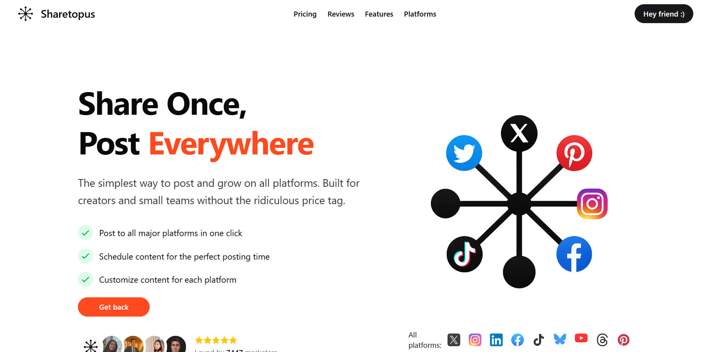
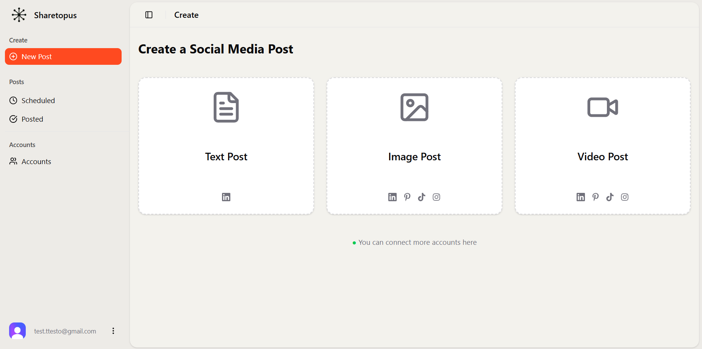
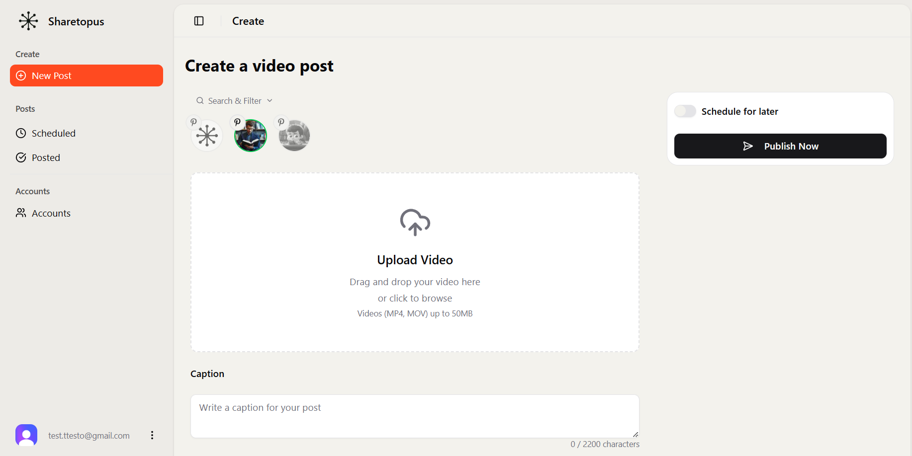

# 🐙 Sharetopus

[](https://nextjs.org)
[](https://www.typescriptlang.org)
[](https://react.dev)
[](https://supabase.com)
[](https://stripe.com)
[](https://clerk.com)
[](https://www.inngest.com)
[](https://tailwindcss.com)
[](https://vercel.com)

[]()
[]()
[]()
[]()

Social media scheduling and publishing from one dashboard, one MCP server, one REST API, and one pay-per-call x402 API. Posting runs end to end on LinkedIn, TikTok, and Pinterest; Instagram, YouTube, X, and Facebook have OAuth and publish code that is not yet verified in production. AI agents (Claude Desktop, Cursor) manage posts on behalf of subscribers through 10 MCP tools. The REST API exposes 31 endpoints with Bearer auth, webhook subscriptions, and OpenAPI docs.

**Production:** [sharetopus.com](https://sharetopus.com)





## 📦 What is Sharetopus

Sharetopus is a SaaS tool for scheduling and publishing social media posts across LinkedIn, TikTok, and Pinterest. You create a post once, customize it per platform, and publish immediately or schedule it for later. Subscribers on Creator plans and above get access to 10 MCP tools and a 31-endpoint REST API. Agents without a subscription pay per action in USDC through x402. Background jobs (23 Inngest functions) handle dispatch, polling, webhook delivery, token encryption, and storage and log cleanup.

## ✨ Surfaces

| Surface | Status | Auth | Description |
|---------|--------|------|-------------|
| Web UI | Shipped | Clerk session | Browser dashboard at sharetopus.com |
| MCP | Shipped | Clerk OAuth / API key | 10 tools for AI agents (Claude Desktop, Cursor) |
| REST API | Shipped | `stp_rest_*` Bearer token | 31 endpoints, webhooks, OpenAPI docs |
| x402 | Shipped | USDC payment per request | Pay-per-action API for agents, 6 networks, no account needed |

**Web App.** Clerk authentication, Stripe billing, post creation with per-platform customization, scheduling calendar, content history. See [docs/ARCHITECTURE.md](./docs/ARCHITECTURE.md).

**MCP Server.** Streamable HTTP at `/api/mcp/mcp`. Requires Creator plan or above ($18/mo). 10 tools: read (connections, posts, analytics), media upload, and posting (one `publish_posts` call publishes now or schedules up to 30 posts). See [docs/MCP.md](./docs/MCP.md).

**REST API.** 31 endpoints under `/api/v1/` with Bearer auth via `stp_rest_*` keys. Every request audited to `rest_audit_log`. Rate-limited per principal. Webhook subscriptions with HMAC-SHA256 signing (5 event types, auto-disable after 10 failures). OpenAPI spec at `/api/v1/openapi.json`, interactive docs at `/docs/api` (Scalar). See [docs/REST.md](./docs/REST.md).

**x402.** Pay-per-action endpoints under `/api/x402/`: connect and reauth an account, post now, schedule, reschedule, cancel, delete, list connections, scheduled posts and history, and mint an upload URL. Each request carries a USDC payment on Base, Polygon, Arbitrum, Celo, Arc, or Solana (`src/lib/x402/networks.ts`), and the paying wallet becomes the account. Prices come from the `pricing_actions` table. Posting is sold for LinkedIn, TikTok, and Pinterest only (`X402_PLATFORMS` in `src/lib/x402/config.ts`). Reference at `/docs/x402`.

## 🛠️ Tech Stack

| Category | Technology | Version |
|----------|-----------|---------|
| Framework | Next.js (App Router, Turbopack) | 16.2.6 |
| Language | TypeScript | 5.9.3 |
| UI | React + Tailwind CSS + shadcn/ui | 19.2.0 / 4.2.4 |
| Auth | Clerk (`@clerk/nextjs`) | 7.3.2 |
| Database | Supabase Postgres via Drizzle ORM (`drizzle-orm` + `postgres`) | 0.45.3 / 3.4.9 |
| Storage | Supabase Storage (`@supabase/supabase-js`) | 2.105.3 |
| Payments | Stripe | 18.5.0 |
| Background Jobs | Inngest | 4.3.0 |
| Rate Limiting | Upstash Redis + `@upstash/ratelimit` | 1.38.0 / 2.0.8 |
| Validation | Zod 4 (REST and MCP) | 4.4.3 |
| OpenAPI | zod-openapi + @scalar/nextjs-api-reference | 5.4.6 / 0.10.16 |
| MDX | @next/mdx + @mdx-js/loader | 16.2.6 / 3.1.1 |
| MCP | `@modelcontextprotocol/server` + `mcp-handler` | 2.1.0 / 2.2.0 |
| Deployment | Vercel | |

Full dependency list: [package.json](./package.json).

## 🚀 Quick Start

```bash
git clone <repo-url>
cd sharetopus
bun install
cp .env.example .env.local
# Fill in all required values (see docs/DEVELOPMENT.md)
bun run dev              # http://localhost:3000
```

Prerequisites: Node.js 20+, Supabase project, Clerk application, Stripe account, Inngest account, Upstash Redis instance, and OAuth apps for each platform you want to test.

Full setup guide: [docs/DEVELOPMENT.md](./docs/DEVELOPMENT.md).

## 🌍 Platforms

| Platform | Media Types | Post Model |
|----------|-------------|------------|
| LinkedIn | text, image, video | Direct upload to LinkedIn CDN |
| TikTok | image, video | Async pull (TikTok fetches media from URL, poll + webhook for completion) |
| Pinterest | image, video | Image: direct URL. Video: streaming multipart S3 upload, then poll |
| Instagram | image, reel | Container model (create container, poll status, publish) |

Details per platform: [docs/PLATFORMS.md](./docs/PLATFORMS.md).

## 🤖 MCP Server

Streamable HTTP at `/api/mcp/mcp`, stateless: mcp-handler 2.x serves protocol 2026-07-28 and 2025-era clients from the same URL. Authenticated via Clerk OAuth tokens or `stp_mcp_*` API keys. Both resolve to a `principal_id` with a cached subscription tier.

10 tools, all requiring Creator plan ($18/mo) or above. A text post takes two calls: `list_connections`, then `publish_posts`.

| Category | Tools |
|----------|-------|
| Read | list_connections, list_pinterest_boards, list_posts, list_billing_summary, get_account_analytics |
| Media (quota-gated) | attach_media_from_url, request_upload_url |
| Posting | publish_posts (quota-gated), update_scheduled_posts, delete_scheduled_posts |

`publish_posts` takes 1 to 30 posts: a post with `scheduled_at` is scheduled, one without it publishes now. Passing the same `batch_id` again makes a retry safe. See [docs/MCP.md](./docs/MCP.md) for parameters and examples.

## ⚡ Background Jobs

23 Inngest functions handle scheduling, posting, polling, token refresh, webhook delivery, encryption, and cleanup:

| Function | Trigger | Purpose |
|----------|---------|---------|
| scheduled-posts-tick | Cron `0 * * * *` | Hourly safety net: re-sends `post.due` for unclaimed posts due within 2 h |
| process-single-post | Event `post.due` | Publish one scheduled post (retries 3, `WORKER_MAX_RETRIES`, capped at 20) |
| process-direct-post | Event `post.now` | Publish one "post now" item (retries 3, `WORKER_MAX_RETRIES`, capped at 20) |
| tiktok-publish-status-poll | Event `tiktok.publish.poll` | Poll TikTok until a publish completes or fails (retries 3) |
| repoll-stalled-tiktok-pulls | Cron `40 * * * *` | Re-send the poll for pending TikTok pulls nobody polled for 10 min |
| process-tiktok-publish-webhook | Event `tiktok.publish.webhook.received` | Handle TikTok publish webhook callbacks (retries 3) |
| sweep-stuck-direct-posts | Cron `15 * * * *` | Fail `pending_direct_posts` rows still `processing` 60 min after creation |
| sweep-orphan-storage-files | Cron `0 3 * * *` | Delete unreferenced storage files (>24h) |
| sweep-stale-oauth-clients | Cron `0 4 * * *` | Remove unverified OAuth clients (>90 days, no activity) |
| cleanup-cancelled-posts-after-grace | Cron `0 5 * * *` | Resume paused posts of owners with access, delete them 7 days after the pause for owners without |
| cleanup-stripe-webhook-events | Cron `0 3 * * *` | Purge processed Stripe webhook events (>90 days) |
| cleanup-mcp-audit-log | Cron `0 4 * * *` | Delete MCP audit log rows (>90 days) |
| cleanup-x402-access-log | Cron `0 6 * * *` | Delete x402 access log rows (>90 days) |
| cleanup-rest-audit-log | Cron `0 7 * * *` | Delete REST audit log rows (>90 days) |
| cleanup-tiktok-webhook-events | Cron `0 8 * * *` | Purge logged TikTok webhook events (>90 days) |
| cleanup-finished-tiktok-pulls | Cron `30 8 * * *` | Delete finished TikTok pulls finalized more than 90 days ago |
| cleanup-social-connections | Cron `0 2 * * *` | Delete pending, failed and expired OAuth connection rows (>30 days) |
| sweep-x402-reconciliation | Cron `20 * * * *` | Resolve or report x402 payments that need a manual look |
| encrypt-plaintext-secrets | Cron `0 9 * * *`, Event `secrets.encrypt-plaintext` | Encrypt social account tokens, webhook secrets and share-link tokens still stored in plaintext (retries 1) |
| refresh-expiring-tokens | Cron `0 1 * * *` | Request a refresh for every account whose token expires within 7 days |
| refresh-social-account-token | Event `social-account.token.refresh` | Refresh one account's token, or flag it for reconnect (retries 3) |
| deliver-webhook | Event `webhook.dispatch.v1` | Deliver one webhook event to a subscriber (HMAC signed, retries 3 per step) |
| record-referral-signup | Event `referral.signup` | Record a referred signup and grant the referrer's reward (retries 3) |

See [docs/INNGEST.md](./docs/INNGEST.md).

## 💳 Billing

Three Stripe subscription tiers. MCP access starts at Creator.

| Tier | Monthly | Yearly | Accounts | Storage | MCP Access |
|------|---------|--------|----------|---------|------------|
| Starter | $9 | $64 | 5 | 5 GB | Web only |
| Creator | $18 | $129 | 15 | 15 GB | All 10 tools (quotas apply) |
| Pro | $27 | $194 | Unlimited | 45 GB | All 10 tools (unlimited) |

See [docs/BILLING.md](./docs/BILLING.md).

## 📚 Documentation

| Document | Description |
|----------|-------------|
| [docs/ARCHITECTURE.md](./docs/ARCHITECTURE.md) | System map, component interactions, data flows, state diagrams |
| [docs/AUTH.md](./docs/AUTH.md) | Clerk, MCP auth (API key + OAuth), principal model, entitlement |
| [docs/BILLING.md](./docs/BILLING.md) | Stripe subscriptions, plan gates, usage quotas |
| [docs/DATABASE.md](./docs/DATABASE.md) | All 35 tables, schema changes with Drizzle, RLS posture |
| [docs/DEVELOPMENT.md](./docs/DEVELOPMENT.md) | Local setup, testing, deployment |
| [docs/INNGEST.md](./docs/INNGEST.md) | 16 background functions, cron schedules, sweep jobs |
| [docs/MCP.md](./docs/MCP.md) | MCP server: 10 tools, auth, withMcpTool HOF, usage examples |
| [docs/REST.md](./docs/REST.md) | REST API: 32 handlers, withRestEndpoint HOF, validation, audit |
| [docs/WEBHOOKS.md](./docs/WEBHOOKS.md) | Webhook subsystem: signing, retry, replay, auto-disable |
| [docs/PLATFORMS.md](./docs/PLATFORMS.md) | Per-platform OAuth, posting flows, quirks |
| [docs/ROADMAP.md](./docs/ROADMAP.md) | Shipped features, deferred work, open issues |
| [docs/SCHEDULING.md](./docs/SCHEDULING.md) | Schedule lifecycle, locks, retries, created_via |
| [docs/SECURITY.md](./docs/SECURITY.md) | Threat model, SSRF, HMAC proxy, rate limits, audit |
| [docs/STORAGE.md](./docs/STORAGE.md) | Supabase Storage, signed URLs, orphan sweep |

## ⚙️ Configuration

Key environment variables (see [docs/DEVELOPMENT.md](./docs/DEVELOPMENT.md) for the full list):

| Category | Variables |
|----------|-----------|
| Auth | `CLERK_SECRET_KEY`, `NEXT_PUBLIC_CLERK_PUBLISHABLE_KEY` |
| Database | `DATABASE_URL` (Supabase transaction pooler, port 6543) |
| Storage | `NEXT_PUBLIC_SUPABASE_URL`, `SUPABASE_SERVICE_ROLE` |
| Payments | `STRIPE_SECRET_KEY`, `STRIPE_WEBHOOK_SECRET` |
| Jobs | `INNGEST_EVENT_KEY`, `INNGEST_SIGNING_KEY` |
| Rate Limiting | `UPSTASH_REDIS_REST_URL`, `UPSTASH_REDIS_REST_TOKEN` |
| Security | `MEDIA_PROXY_HMAC_SECRET` (64 hex), `MCP_IP_HASH_SALT` (32 bytes base64) |
| Platforms | `LINKEDIN_CLIENT_ID/SECRET`, `TIKTOK_CLIENT_KEY/SECRET`, `PINTEREST_CLIENT_ID/SECRET`, `INSTAGRAM_CLIENT_ID/SECRET` |

## 🔒 Security

Authentication is split by surface: Clerk sessions for web, Clerk OAuth or API keys for MCP, Bearer tokens (`stp_rest_*`) for REST API. All surfaces resolve to a `principal_id` in the `principals` table. Rate limiting uses Upstash Redis sliding windows. Two append-only audit logs: `mcp_audit_log` (MCP tool calls) and `rest_audit_log` (REST API requests), each kept 90 days; retention per table is in docs/SECURITY.md. SSRF protection blocks 14 private/reserved IP ranges on media downloads. HMAC-signed proxy URLs serve media to TikTok without exposing credentials. Outbound webhooks are HMAC-SHA256 signed per subscription secret. Stripe and TikTok inbound webhooks are verified via signatures with idempotency tables preventing replay.

Full security architecture: [docs/SECURITY.md](./docs/SECURITY.md).

## 🛣️ Roadmap

**Recently shipped:** x402 pay-per-action API on 6 networks, REST API v1 (32 handlers), webhook subsystem (HMAC + delivery + replay), OpenAPI + Scalar docs, MDX doc pages, Zod 4 upgrade, TikTok webhook integration, hybrid pricing, withMcpTool HOF, API key expiry, generic adapter pattern, OAuth client trust enforcement, data retention crons.

**Mid-term:** Instagram, YouTube, X, and Facebook verified in production, additional platforms. **Long-term:** Analytics pipeline, federated agent features.

Full roadmap: [docs/ROADMAP.md](./docs/ROADMAP.md).

## ⚠️ Known Limitations

- Instagram, YouTube, X, and Facebook have OAuth and publish code but are not yet verified in production, so x402 does not sell them.
- i18n is declared (fr, en, es) but no translation files exist. UI is English only.
- Studio/Analytics page shows "Coming Soon". The analytics_metrics table exists but has no data pipeline.
- TikTok default privacy is SELF_ONLY (private). Users must select a public level.
- `next.config.ts` sets `typescript.ignoreBuildErrors: true` for Vercel OOM mitigation. Type checking runs via `bunx tsc --noEmit` in CI/pre-commit instead.

## 🤝 Contributing

This is a private project. See [docs/DEVELOPMENT.md](./docs/DEVELOPMENT.md) for the development setup, code conventions, and deployment process.

## 📄 License

No LICENSE file in the repository.

## 🌐 Live

**Production:** [https://sharetopus.com](https://sharetopus.com)

**Demo:** [https://x.com/Andy00L/status/2033366044941643828](https://x.com/Andy00L/status/2033366044941643828)
