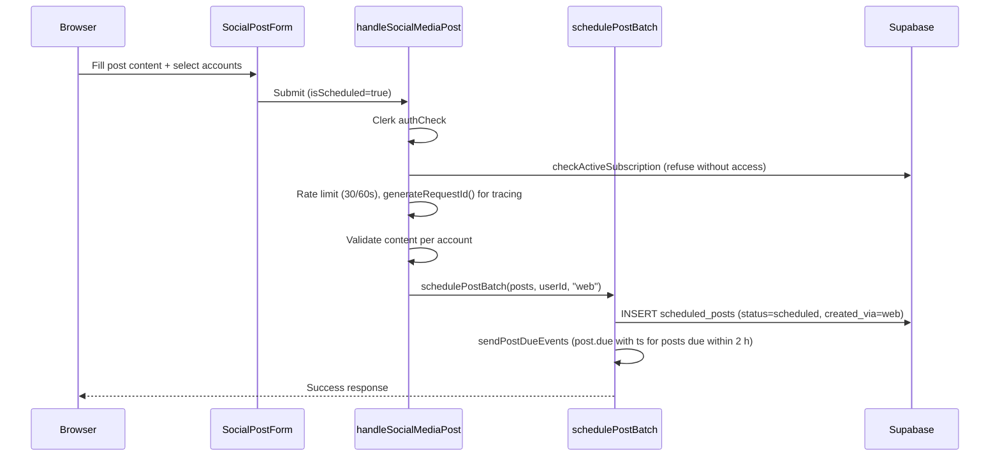
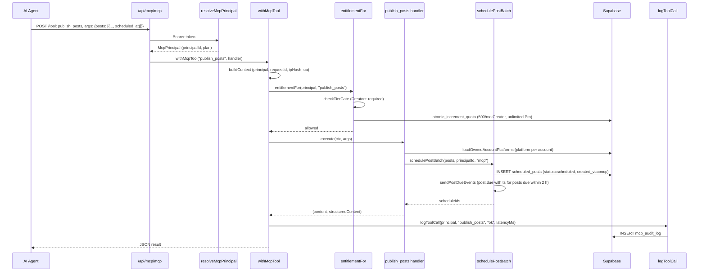
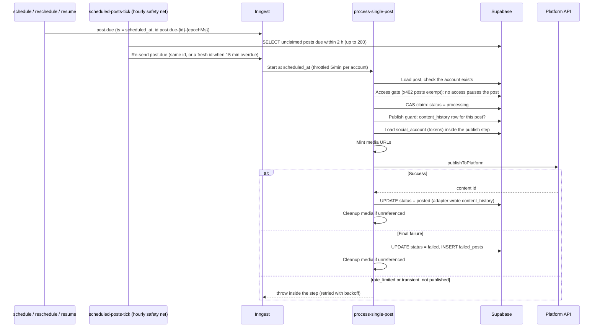
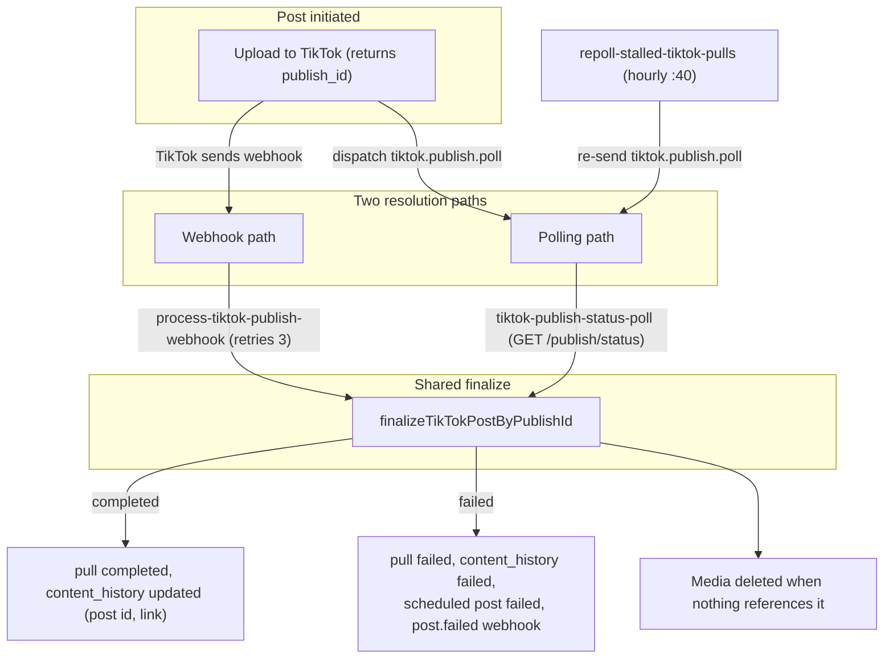
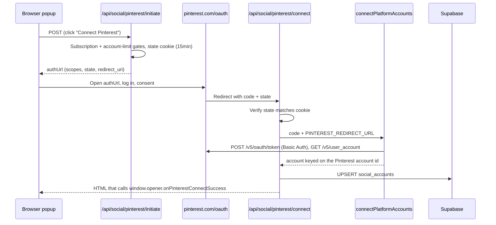
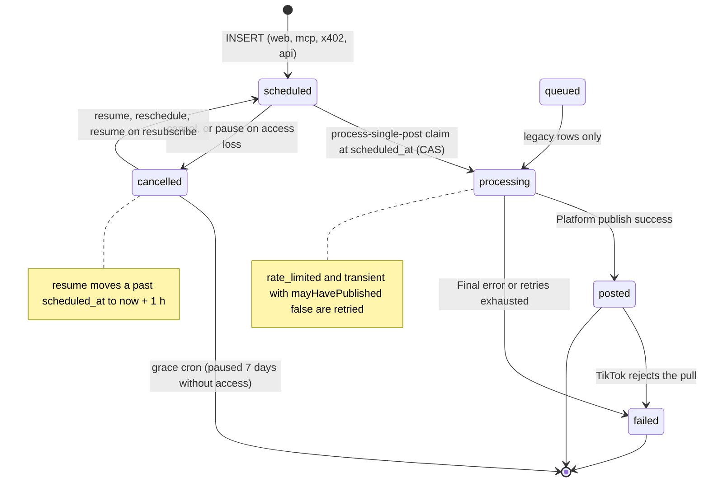

# Architecture

System architecture for Sharetopus: a Next.js 16 SaaS app with an MCP server, a REST API, x402 pay-per-call routes, Inngest background jobs, and integrations with 28 social platforms (7 dedicated adapters and 21 registry providers).

35 database tables. 10 MCP tools. 32 REST API handlers. 23 Inngest functions.

[Back to README](../README.md)

## Table of contents

- [System overview](#system-overview)
- [Directory structure](#directory-structure)
- [Data flows](#data-flows)
  - [Web user schedules a post](#web-user-schedules-a-post)
  - [MCP agent schedules a post](#mcp-agent-schedules-a-post)
  - [Inngest processes a scheduled post](#inngest-processes-a-scheduled-post)
  - [TikTok async publish (webhook + polling)](#tiktok-async-publish-webhook--polling)
  - [Pinterest OAuth flow](#pinterest-oauth-flow)
- [State diagrams](#state-diagrams)
  - [scheduled_posts.status](#scheduled_postsstatus)
  - [pending_direct_posts.status](#pending_direct_postsstatus)
- [Error handling](#error-handling)
- [Design tradeoffs](#design-tradeoffs)
- [Tech stack](#tech-stack)
- [Source files referenced](#source-files-referenced)

## System overview

```mermaid
graph TD
    subgraph Client["Client Layer"]
        Browser["React 19 SPA (App Router)"]
        AI["AI Agents (Claude Desktop, Cursor)"]
        Wallet["Wallets (x402, Solana Blink)"]
    end

    subgraph Edge["Proxy"]
        ClerkMW["Clerk middleware (src/proxy.ts), skipped on machine routes"]
    end

    subgraph Server["Next.js Server (Vercel, 300s max)"]
        subgraph Actions["Server Actions"]
            PubActions["Server actions (Clerk session + rate limit)"]
            Batches["Batch cores (schedulePostBatch, directPostBatch, cancel, resume, reschedule, delete)"]
        end
        subgraph API["API Routes"]
            SocialRoutes["Social OAuth routes"]
            StorageRoutes["Storage URL Routes"]
            WebhookRoutes["Webhook Handlers (Clerk, Stripe, TikTok)"]
            PostStatus["Post Status Polling"]
            X402Routes["x402 pay-per-call routes"]
        end
        subgraph RESTAPI["REST API v1 (32 handlers)"]
            RESTRoute["/api/v1/* (posts, connections, media, webhooks, analytics)"]
            RESTAuth["withRestEndpoint (Bearer stp_rest_*)"]
            RESTAudit["rest_audit_log (append-only)"]
        end
        subgraph MCP["MCP Server"]
            MCPRoute["POST /api/mcp/mcp"]
            MCPAuth["withMcpAuth (Bearer token)"]
            MCPTools["10 Tools, 3 Prompts"]
        end
    end

    subgraph Background["Background (Inngest, 23 functions)"]
        subgraph EventHandlers["Event-driven (7)"]
            Worker["process-single-post (post.due, retries 3)"]
            DirectWorker["process-direct-post (post.now, retries 3)"]
            TikTokPoll["tiktok-publish-status-poll (tiktok.publish.poll, retries 3)"]
            TikTokWebhook["process-tiktok-publish-webhook (tiktok.publish.webhook.received, retries 3)"]
            WebhookDeliver["deliver-webhook (webhook.dispatch.v1)"]
            TokenRefresh["refresh-social-account-token (social-account.token.refresh, retries 3)"]
            ReferralSignup["record-referral-signup (referral.signup, retries 3)"]
        end
        subgraph Crons["Cron jobs (16)"]
            Dispatcher["scheduled-posts-tick (hourly :00, safety net)"]
            StuckSweep["sweep-stuck-direct-posts (hourly :15)"]
            ReconSweep["sweep-x402-reconciliation (hourly :20)"]
            TikTokRepoll["repoll-stalled-tiktok-pulls (hourly :40)"]
            TokenCron["refresh-expiring-tokens (daily 01:00)"]
            ConnectionSweep["cleanup-social-connections (daily 02:00)"]
            OrphanSweep["sweep-orphan-storage-files (daily 03:00)"]
            StripeSweep["cleanup-stripe-webhook-events (daily 03:00)"]
            OauthSweep["sweep-stale-oauth-clients (daily 04:00)"]
            AuditSweep["cleanup-mcp-audit-log (daily 04:00)"]
            GraceSweep["cleanup-cancelled-posts-after-grace (daily 05:00)"]
            X402LogSweep["cleanup-x402-access-log (daily 06:00)"]
            RestLogSweep["cleanup-rest-audit-log (daily 07:00)"]
            TikTokEventSweep["cleanup-tiktok-webhook-events (daily 08:00)"]
            TikTokPullSweep["cleanup-finished-tiktok-pulls (daily 08:30)"]
            SecretEncrypt["encrypt-plaintext-secrets (daily 09:00, event secrets.encrypt-plaintext)"]
        end
    end

    subgraph Data["Data Layer"]
        Supabase["Supabase Postgres (35 tables, Drizzle)"]
        Storage["Supabase Storage (scheduled-videos)"]
        Redis["Upstash Redis (rate limits, token refresh lock)"]
    end

    subgraph External["External Services"]
        Clerk["Clerk (Auth + Webhooks)"]
        Stripe["Stripe (Billing + Webhooks)"]
        Adapters["7 adapter platforms (LinkedIn, TikTok, Pinterest, Instagram, Facebook, YouTube, X)"]
        Registry["21 registry providers (Bluesky, Mastodon, Threads, ...)"]
        Facilitator["x402 facilitators and chains"]
    end

    Browser --> ClerkMW --> PubActions
    Browser --> RESTRoute
    AI --> MCPRoute
    AI --> RESTRoute
    Wallet --> X402Routes
    RESTRoute --> RESTAuth --> RESTAudit
    RESTAuth --> Batches
    MCPRoute --> MCPAuth --> MCPTools
    MCPTools --> Batches
    X402Routes --> Facilitator
    X402Routes --> Batches
    PubActions --> Batches
    PubActions --> Redis
    Batches --> Supabase
    Batches -->|post.due, post.now| Background
    Actions --> StorageRoutes
    StorageRoutes --> Storage
    Dispatcher --> Worker
    Worker --> Adapters & Registry
    DirectWorker --> Adapters & Registry
    TikTokPoll --> Adapters
    TikTokRepoll --> TikTokPoll
    TokenCron --> TokenRefresh
    TikTokWebhook --> Supabase
    WebhookDeliver --> Supabase
    OrphanSweep --> Storage
    Clerk -->|webhooks| WebhookRoutes
    Stripe -->|webhooks| WebhookRoutes
    Adapters -->|TikTok webhooks| WebhookRoutes
    WebhookRoutes --> Supabase
```



## Directory structure

```
src/
  actions/
    api/
      adminSupabase.ts          # Service-role Supabase client, used for Storage only
    client/
      signedUrlUpload.ts        # Client-side XHR upload with progress
    server/
      accounts/                 # disconnectSocialAccount
      api/                      # apiKeys (create, list, revoke REST and MCP keys)
      connections/              # checkAccountLimits (plan-gated)
      contentHistoryActions/    # storeContentHistory, storeFailedPost, getContentHistory
      data/                     # pendingDirectPosts, pendingTikTokPulls, fetchAccountForPublish,
                                # finalizeTikTokPostByPublishId, orphanStorageSweep,
                                # sweepStaleOauthClients, cleanupCancelledPostsAfterGrace,
                                # cancelFutureScheduledPostsOnSubCancel, resumeCancelledPostsOnResubscribe,
                                # generateServerSignedUploadUrl, getServerSignedViewUrl, storageFiles/
      directPostActions/        # directPostBatch (post now fan-out)
      handleSocialMediaPost/    # Web posting handler (access check, direct + scheduled)
      rateLimit/                # checkRateLimit (Upstash sliding window), rateLimitRules
      referral/                 # Referral code and progress reads
      scheduleActions/          # schedule, cancel, resume, reschedule, delete batch cores
      share-link/               # Share links for connecting accounts
      stripe/                   # checkOutSession, customerPortal, stripeEventLog,
                                # recordInvoicePayment, toSubscriptionRow
      ensureUserExists.ts       # Creates the user and Stripe customer, sends referral.signup
    checkActiveSubscription.ts  # Access rule: single, batch, and the x402 exemption
  app/
    (marketing)/                # Landing page, Privacy Policy, ToS, /proof (x402 payment ledger), /solana (Solana ledger, Blink link)
      (api-reference)/docs/     # REST, MCP and x402 reference pages
      docs/                     # Guides; docs/api serves the OpenAPI viewer (force-static)
    (protected)/                # Authenticated routes
      error.tsx                 # One error boundary for every protected page
      connections/              # Social account management
      create/                   # Post creation (text/image/video)
      integrations/             # Integration status page
      payment/                  # Checkout + success page
      posted/                   # Content history view
      referral/                 # Referral program
      scheduled/                # Scheduled posts view
      settings/webhooks/        # Webhook subscriptions
      studio/                   # Analytics (Coming Soon)
      userProfile/              # Clerk user profile
    .well-known/
      oauth-protected-resource/ # RFC 9728 OAuth discovery for MCP clients
    share/[platform]/           # Share-link pages: connect an account for the link's owner
    actions.json/               # Solana Actions manifest for Blink clients (force-static)
    llms.txt/                   # Docs index for LLM clients (force-static)
    api/
      actions/                  # Solana Blink (post now paid in USDC)
      auth/[clerk]/             # Clerk auth UI
      docs/                     # Markdown docs (CDN cached)
      inngest/                  # Inngest serve() endpoint (23 functions)
      mcp/mcp/                  # MCP server (mcp-handler 2.x: protocol 2026-07-28 + 2025-era clients)
      v1/                       # REST API v1 (32 handlers)
      media/                    # HMAC-signed media proxy
      oauth/callback/           # OAuth callback for REST, MCP, share-link and x402 connections
      posts/status/             # Inngest job status polling (max 50 event IDs)
      social/
        {platform}/             # OAuth initiate and connect per adapter platform
        registry/               # OAuth and credentials for registry providers
      storage/
        generate-upload-url/    # Signed upload URL (Clerk-authed)
      webhooks/
        clerk/                  # user.created, user.updated, user.deleted
        stripe/                 # customer.subscription.*, invoice.*
        tiktok/publish/         # TikTok Content Posting webhooks
      x402/                     # Pay-per-call routes: connect, connections, reauth, oauth,
                                # post-now, schedule, reschedule, cancel, delete,
                                # scheduled-posts, history, upload-url, facilitator
  components/                   # One folder per domain (core, connections, marketing-page, referral, sidebar, webhooks, ui, ...)
  db/
    client.ts                   # Drizzle client (postgres.js, transaction pooler) + runQuery
    schema.ts                   # Drizzle schema: every table, the source of truth
  inngest/
    client.ts                   # Inngest client (id: "sharetopus")
    dispatch/                   # sendPostDueEvents, dispatchPostNowEvents
    events/                     # Event schemas (eventType): post.due, post.now, tiktok.publish.poll,
                                # social-account.token.refresh, referral.signup, webhook.dispatch.v1,
                                # stored post_options
    functions/                  # 23 functions, see docs/INNGEST.md
  lib/
    api/
      _shared/                  # directPostForAccountsGeneric, platformFailure, platformFetchTimeouts,
                                # buildStreamingMultipartFormDataBody
      oauth/                    # initiateWebOAuth, completeWebOAuthConnect, connectPlatformAccounts
      facebook/ instagram/ linkedin/ pinterest/ tiktok/ x/ youtube/   # The 7 adapters
      ensureValidToken.ts       # Token refresh for adapter platforms
      refreshWithAccountLock.ts # One refresh per account at a time (Redis lock)
      rest/                     # REST API: auth, audit, errors, middleware, validation,
                                # webhooks, openapi, dto, adapters, docs
    crypto/                     # tokenEncryption (encrypted columns)
    jobs/                       # runtimeConfig, retention, deleteExpiredRows
    mcp/
      auth/                     # resolveMcpPrincipal, OAuth client trust
      audit.ts                  # logToolCall, arg redaction
      context.ts                # extractPrincipal, extractRequestId
      entitlement.ts            # Plan gating (Creator+ minimum) + monthly quota enforcement
      withMcpTool.ts            # HOF wrapper: rate limit, entitlement, audit, error handling
      _shared/                  # safeUserFetch, enforceStorageQuota, currentQuotaPeriod
      tools/                    # 10 tool definitions (one file per tool, Zod 4 schemas)
      prompts/                  # 3 prompt definitions (auditCalendar, planWeekForPlatform, repurposePost)
    net/                        # pinnedFetch (SSRF-safe pinned DNS), ipBlocklist, describeNetworkError
    platforms/
      capabilities.ts           # Platform catalog: adapter ids, media types, hotlinking
      providers/                # Registry providers, publishViaRegistry, refreshRegistryAccountToken
    referral/                   # Referral rules, recordReferralOnSignup, triggerReferralGrant
    solanaActions/              # Solana Blink payment and post now
    storage/                    # mediaBucket, mediaPath, getUserStorageBytes
    types/                      # dbTypes (inferred from schema), plans, postBatch
    utils/                      # generateRequestId and other helpers
    x402/                       # Pay-per-call: auth, charges, payment, pricing, proof,
                                # facilitator, middleware, oauth, connect, chains
```

## Data flows

### Web user schedules a post



### MCP agent schedules a post

MCP access requires the Creator plan or higher. Starter users have zero MCP access. All 10 tools enforce this via the `withMcpTool` HOF, which runs entitlement checks before any business logic.



### Inngest processes a scheduled post



### TikTok async publish (webhook + polling)

TikTok's Content Posting API is asynchronous. After the initial upload, TikTok returns a `publish_id` but the post is not live yet. Sharetopus resolves final status through two parallel paths that both converge on the same function.



Whichever path fires first writes the final state: the finalize moves the pull out of `pending` with a guarded UPDATE, so if both paths resolve (e.g., webhook arrives after polling already completed), the second call is a no-op. A later `post.publish.publicly_available` still backfills the TikTok post id. A pending pull nobody polled for 10 minutes gets a new poll from the hourly repoll cron.

### Pinterest OAuth flow

Every dedicated platform follows this shape. The initiate and connect routes are a few lines of config over `initiateWebOAuth` and `completeWebOAuthConnect`; `connectPlatformAccounts` holds the per-platform exchange and profile read, and the x402/REST callback (`handleOAuthCallback`) calls the same function with the redirect URI stored on its `social_connections` row.



## State diagrams

### scheduled_posts.status



See [SCHEDULING.md](./SCHEDULING.md#status-transitions) for the trigger of each transition.

### pending_direct_posts.status

```mermaid
stateDiagram-v2
    [*] --> processing: lockPendingDirectPosts (before Inngest dispatch)
    processing --> [*]: releasePendingDirectPosts (inngest.send failed, row deleted)
    processing --> completed: process-direct-post success, or onFailure finds the post published
    processing --> failed: process-direct-post failure or retries exhausted
    processing --> failed: sweep-stuck-direct-posts (60 min after created_at)
    completed --> [*]
    failed --> [*]

    note right of processing: Lock row. Prevents premature media cleanup.
    note left of failed: sweep-stuck-direct-posts runs hourly at :15
```

## Error handling

The codebase uses an errors-as-values pattern at service boundaries. Functions return `{ success: boolean; message: string; data?: T }` instead of throwing exceptions. This keeps error handling explicit at every call site.

```typescript
// Pattern used throughout server actions:
{ success: true, message: "Post scheduled", data: { scheduleId: "..." } }
{ success: false, message: "Rate limited", resetIn: 45 }
{ success: false, message: "Account not found" }
```

Exceptions are thrown only inside Inngest steps, where Inngest retries only a step that throws: a failed database read or write, and a retryable platform failure. Final failures (policy rejection, invalid input) are recorded and the function returns normally. The Stripe webhook route also throws inside its handlers, so the route answers 500 and Stripe redelivers.

Platform errors arrive typed: each adapter and registry provider returns `failure: { reason, mayHavePublished }` (`src/lib/api/_shared/platformFailure.ts`), and `isSafeToRetryPost` in `src/inngest/functions/platformErrors.ts` decides:
- **Retried**: `rate_limited`, `transient` (network timeouts, connection resets), only when `mayHavePublished` is false
- **Final**: `auth_expired`, `policy_rejected` (platform policy violation), `invalid_input` (wrong post type, missing board), `unknown`, and any failure that may have published

The `withMcpTool` HOF handles MCP-layer errors. If entitlement denies the request, it writes an audit row with status `denied` or `quota_exceeded` and returns a structured error to the agent. If the handler throws, the HOF logs the exception, writes an `error` audit row and returns a generic tool error ("<tool> failed with an internal error. Retry, or contact support if it persists."), so the raw exception text never reaches the agent.

## Design tradeoffs

**Principals table (unified identity).** `principals.kind` is `clerk` or `wallet`. Every other table FKs to `principal_id`, not `user_id`. This adds a join when you only care about Clerk users, but it lets x402 wallet principals own connections, posts and charges in the same tables.

**created_via enum.** Every post-related table stores `created_via: web | mcp | x402 | api`. This was threaded through all scheduling and posting paths so analytics can distinguish origin. The cost is an extra parameter passed through several layers.

**withMcpTool HOF.** Every MCP tool handler is wrapped by `withMcpTool`, which handles: (1) extract per-request context (principal, request id, ipHash, user agent), (2) apply the per-user budget of 100 tool calls per 60 s, (3) run entitlement gate (tier check + monthly quota via atomic RPC), (4) call business logic, (5) emit audit row with latency. Tool handlers only contain business logic. The HOF also supports per-tool `auditArgsBuilder` for scrubbing large or sensitive args before they reach `mcp_audit_log`.

**Generic adapter pattern.** `directPostForAccountsGeneric.ts` provides a single code path for direct posting across the 7 adapter platforms, and every adapter returns the same `DirectPostScheduleResult` with a typed failure. Platform-specific logic is injected via callbacks. The 21 registry providers share `publishViaRegistry` instead. Both workers call one function, `publishToPlatform`, which picks the adapter or the registry.

**TikTok dual-path resolution.** TikTok publishes are async (you get a `publish_id`, not a final status). Both webhook and polling paths exist because webhooks are faster but not 100% reliable. Both converge on `finalizeTikTokPostByPublishId`, which is idempotent. The second path to arrive is a no-op.

**Stateless MCP (mcp-handler 2.x).** The server speaks the 2026-07-28 protocol revision, which is stateless by design, and serves 2025-era clients through the SDK's stateless Streamable HTTP fallback from the same handler. Each request resolves the principal independently, and each tool call is recorded in `mcp_audit_log` under a per-request ID; no table tracks sessions. No `subscriptions/listen` streams are served: tools and prompts never change at runtime, and on Vercel each stream would hold a function open.

**Shared batch cores.** The batch functions (`schedulePostBatch`, `directPostBatch`, and the cancel, resume, reschedule and delete batches) take a principal id and skip Clerk auth. The web server actions, the MCP tools, the REST handlers and the x402 routes each authenticate the caller their own way, then call the same batch. Rules that must hold on every path (rate limits, the daily cap, the access check before a cancelled post comes back) live in the batch. The `server-only` package keeps these modules out of client bundles.

**Server-side database access.** All server code queries Postgres through the Drizzle client (`src/db/client.ts`), which connects through the Supabase transaction pooler as the `postgres` role, a role that bypasses RLS. Supabase's service-role client (`adminSupabase`) remains for Storage only. This is simpler than managing RLS policies for server-side operations but means the application layer is responsible for all access control. Every action manually checks `principal_id` ownership.

**Web requestId tracing.** Public server actions call `generateRequestId()` and pass the ID through the call chain. This ties together the server action, any Inngest events dispatched, and the resulting background work, making it possible to trace a user action end-to-end in logs.

**Inngest over pg_cron.** Background jobs use Inngest (hosted) instead of Postgres cron extensions. Inngest provides retry with backoff, per-account throttling, event-driven dispatch, and observability without self-hosting infrastructure. The tradeoff is a dependency on Inngest's hosted service and the 300-second Vercel function timeout ceiling.

**Streaming multipart for Pinterest video.** Pinterest requires uploading video files to S3 via multipart form-data. The `buildStreamingMultipartFormDataBody` helper streams the file chunk-by-chunk (~64KB) to avoid loading the entire video into memory. This adds complexity (Content-Length precomputation, `duplex: "half"` on fetch) but keeps memory usage bounded even for 250 MB videos.

**4 surfaces.** The system has 4 access surfaces: Web, MCP, REST API, and x402 pay-per-call (plus the Solana Blink, which posts as `x402`). The `created_via` enum and `principals` table accommodate all four. The REST API uses a `withRestEndpoint` HOF similar to `withMcpTool`, centralizing auth, validation, audit logging, and rate limiting. x402 routes go through `x402PaidEndpoint`, which settles the payment before the handler runs.

**Zod 4 everywhere.** The codebase runs Zod 4 (`zod@^4.4.3`), and REST, OpenAPI and MCP code all import `from "zod"`. The v2 MCP SDK needs Zod 4.2 or later to convert tool schemas to JSON Schema. Ids use `z.guid()` rather than `z.string().uuid()` in both surfaces, because Zod 4's strict RFC 4122 validation rejected some Supabase-generated UUIDs.

**Webhook delivery via Inngest.** Outbound webhook delivery is handled by the `deliver-webhook` Inngest function, not inline in the HTTP request. This decouples delivery latency from the API response. Each delivery is HMAC-SHA256 signed with the subscription's secret. A failed POST is retried after 30 s, 2 min and 10 min, each attempt in its own step. Subscriptions auto-disable after 10 failed deliveries in a row.

## Tech stack

Versions from `package.json` (ranges resolve to at least this version).

| Category | Package | Version |
|----------|---------|---------|
| Framework | next | 16.2.6 |
| React | react / react-dom | 19.2.8 |
| TypeScript | typescript | 5.9.3 |
| CSS | tailwindcss | 4.2.4 |
| Auth | @clerk/nextjs | 7.9.4 |
| MCP Auth | @clerk/mcp-tools | 0.5.0 |
| Database | drizzle-orm + postgres (postgres.js) | 0.45.3 / 3.4.9 |
| Migrations | drizzle-kit | 0.31.11 |
| Storage | @supabase/supabase-js | 2.105.3 |
| Payments | stripe | 18.5.0 |
| Background Jobs | inngest | 4.3.0 |
| Rate Limiting | @upstash/ratelimit | 2.0.8 |
| Redis | @upstash/redis | 1.38.0 |
| MCP SDK | @modelcontextprotocol/server | 2.1.0 |
| MCP Handler | mcp-handler | 2.2.0 |
| HTTP (pinned DNS) | undici | 8.7.0 |
| Validation | zod (v4) | 4.4.3 |
| OpenAPI | zod-openapi | 5.4.6 |
| API Docs | @scalar/nextjs-api-reference | 0.10.16 |
| MDX | @next/mdx + @mdx-js/loader | 16.2.6 / 3.1.1 |
| UI Components | shadcn (Radix UI) | 4.7.0 |
| Date Handling | date-fns | 4.1.0 |
| ID Generation | nanoid | 5.1.11 |
| Webhooks | svix | 1.92.2 |
| Drag & Drop | @dnd-kit | core 6.3.1 |
| x402 | @x402/core, @x402/evm, @coinbase/x402, @coinbase/cdp-sdk, viem, @solana/kit | |
| Deployment | Vercel | |

## Source files referenced

| File | What it does |
|------|-------------|
| `src/app/api/inngest/route.ts` | Inngest serve() endpoint, registers all 23 functions |
| `src/inngest/client.ts` | Inngest client instance (id: "sharetopus") |
| `src/inngest/dispatch/sendPostDueEvents.ts` | Sends `post.due` from every writer of `scheduled_at` |
| `src/inngest/functions/scheduledPostsTick.ts` | Cron: hourly safety net for `post.due` |
| `src/inngest/functions/processSinglePost.ts` | Event worker: access gate, claim, publish one scheduled post |
| `src/inngest/functions/processDirectPost.ts` | Event worker: process one direct post |
| `src/inngest/functions/publishToPlatform.ts` | One publish path for adapters and registry providers |
| `src/inngest/functions/tikTokPublishStatusPoll.ts` | Event worker: poll TikTok publish status |
| `src/inngest/functions/repollStalledTikTokPullsCron.ts` | Cron: re-send the poll for stalled TikTok pulls |
| `src/inngest/functions/processTikTokPublishWebhook.ts` | Event worker: handle TikTok publish webhook |
| `src/inngest/functions/sweepStuckDirectPosts.ts` | Cron: recover stuck direct posts |
| `src/inngest/functions/sweepOrphanStorageFiles.ts` | Cron: delete unreferenced storage files |
| `src/inngest/functions/cleanupStripeWebhookEvents.ts` | Cron: purge Stripe webhook events older than 90 days |
| `src/inngest/functions/sweepStaleOauthClientsCron.ts` | Cron: purge unverified OAuth clients older than 90 days |
| `src/inngest/functions/cleanupMcpAuditLogCron.ts` | Cron: purge mcp_audit_log rows older than 90 days |
| `src/inngest/functions/cleanupX402AccessLogCron.ts` | Cron: purge x402_access_log rows older than 90 days |
| `src/inngest/functions/cleanupRestAuditLogCron.ts` | Cron: purge rest_audit_log rows older than 90 days |
| `src/inngest/functions/cleanupFinishedTikTokPullsCron.ts` | Cron: purge finished TikTok pulls older than 90 days |
| `src/inngest/functions/cleanupCancelledPostsAfterGraceCron.ts` | Cron: resume or delete posts paused by access loss |
| `src/inngest/functions/encryptPlaintextSecretsCron.ts` | Cron and event: encrypt secrets still in plaintext |
| `src/inngest/functions/refreshExpiringTokensCron.ts` | Cron: request refreshes for tokens expiring within 7 days |
| `src/inngest/functions/refreshSocialAccountToken.ts` | Event worker: refresh one account's token |
| `src/inngest/functions/recordReferralSignup.ts` | Event worker: record a referral and grant the reward |
| `src/inngest/functions/platformErrors.ts` | Retry rule (`isSafeToRetryPost`) |
| `src/lib/mcp/withMcpTool.ts` | HOF: rate limit, entitlement, audit, error handling for MCP tools |
| `src/lib/mcp/entitlement.ts` | Plan gating (Creator+ minimum) + monthly quota enforcement |
| `src/lib/mcp/auth/resolve.ts` | resolveMcpPrincipal (API key + OAuth paths) |
| `src/lib/mcp/audit.ts` | logToolCall, arg redaction |
| `src/lib/mcp/context.ts` | Extract principal and requestId from MCP request |
| `src/lib/api/_shared/directPostForAccountsGeneric.ts` | Generic direct-post adapter for the 7 adapter platforms |
| `src/lib/api/_shared/platformFailure.ts` | Typed platform failure (`PlatformFailureReason`, `mayHavePublished`) |
| `src/lib/api/_shared/buildStreamingMultipartFormDataBody.ts` | Streaming multipart for Pinterest video |
| `src/lib/platforms/providers/publishViaRegistry.ts` | Publish and token refresh for registry providers |
| `src/actions/server/data/finalizeTikTokPostByPublishId.ts` | Shared TikTok finalize (webhook + polling converge here) |
| `src/actions/checkActiveSubscription.ts` | Access rule shared by pages, actions, workers, MCP and REST |
| `src/db/client.ts` | Drizzle client and `runQuery` (errors as values) |
| `src/db/schema.ts` | Drizzle schema, the source of truth for every table |
| `src/actions/api/adminSupabase.ts` | Service-role Supabase client, used for Storage only |
| `src/lib/utils/generateRequestId.ts` | Web requestId tracing for server actions |
| `src/lib/types/dbTypes.ts` | App row aliases (`SocialAccount`, `ContentHistory`, ...) inferred from the Drizzle tables |
| `src/lib/api/rest/middleware/withRestEndpoint.ts` | REST API endpoint wrapper (auth, validation, audit, rate limit) |
| `src/lib/api/rest/webhooks/dispatch.ts` | Webhook event dispatch to Inngest |
| `src/lib/api/rest/openapi/buildDocument.ts` | OpenAPI 3.1 document generation (memoized per instance) |
| `src/inngest/functions/deliverWebhook.ts` | Inngest function: deliver one webhook event |
| `src/lib/types/plans.ts` | Plan tiers, tier comparison, price ID mapping |
| `src/proxy.ts` | Clerk middleware (Next.js proxy), skipped on machine routes |

---

**See also:** [docs/SECURITY.md](./SECURITY.md) (security architecture, threat model), [docs/MCP.md](./MCP.md) (tool inventory, auth flow), [docs/REST.md](./REST.md) (REST API endpoints), [docs/WEBHOOKS.md](./WEBHOOKS.md) (webhook subsystem), [docs/DATABASE.md](./DATABASE.md) (schema details), [docs/INNGEST.md](./INNGEST.md) (background jobs detail)

[Back to README](../README.md)
