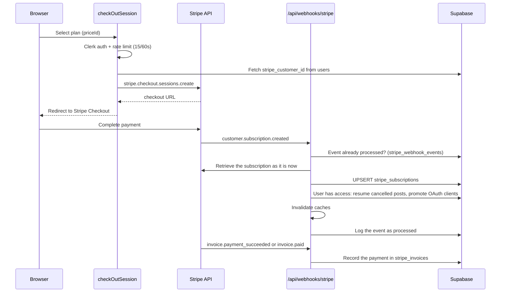
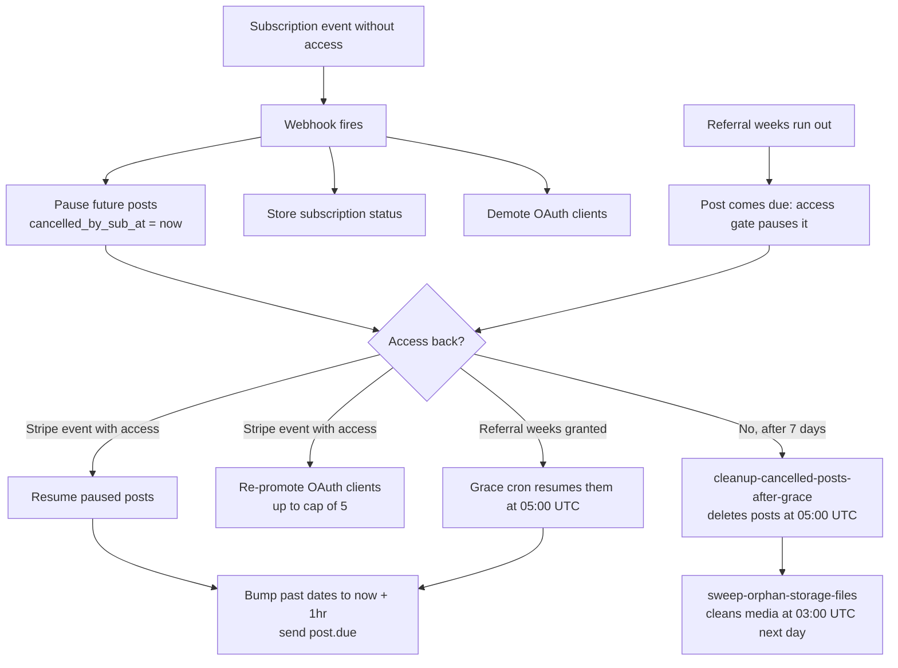
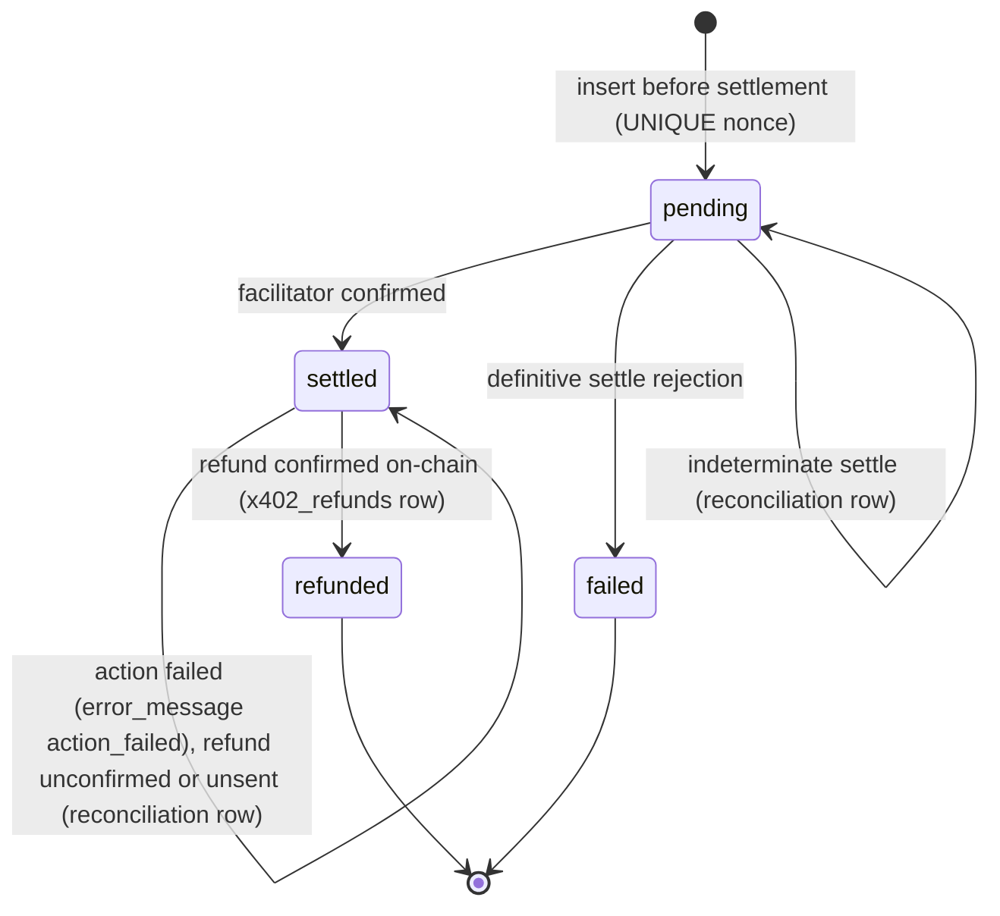

# Billing

Stripe handles subscriptions and payments. Three tiers with monthly and yearly pricing. Plan gates control web UI access, MCP tool access, account limits, and storage quotas. MCP access requires Creator tier or above (Starter is web-only).

[Back to README](../README.md)

## Table of contents

- [Plan tiers](#plan-tiers)
- [Stripe subscription flow](#stripe-subscription-flow)
- [Webhook events](#webhook-events)
- [Subscription status](#subscription-status)
- [Plan gating](#plan-gating)
  - [Account limits](#account-limits)
  - [MCP tool access by tier](#mcp-tool-access-by-tier)
  - [Storage quotas](#storage-quotas)
- [MCP monthly quotas](#mcp-monthly-quotas)
- [Upload limits](#upload-limits)
- [Customer portal](#customer-portal)
- [Usage tracking](#usage-tracking)
- [Subscription lifecycle](#subscription-lifecycle)
  - [Cancel](#cancel-period_end-customersubscriptiondeleted)
  - [Resubscribe](#resubscribe-customersubscriptioncreated)
  - [Grace period](#grace-period-7-days)
  - [Publish-time access gate](#publish-time-access-gate)
- [Referral weeks](#referral-weeks)
- [x402 Pay-Per-Call](#x402-pay-per-call)
- [Source files referenced](#source-files-referenced)

## Plan tiers

| Tier | Monthly | Yearly (~40% off) | Connected accounts | Storage | Web UI | MCP access |
|------|---------|--------------------|--------------------|---------|--------|------------|
| Starter | $9 | $64 | 5 | 5 GB | Yes | No |
| Creator (popular) | $18 | $129 | 15 | 15 GB | Yes | Yes (quota-limited) |
| Pro | $27 | $194 | 999 (unlimited) | 45 GB | Yes | Yes (unlimited) |

Starter users get full web UI access but zero MCP tool access. This is the hybrid pricing model: web for everyone, MCP for Creator and above. All 10 MCP tools require Creator minimum via `ACTION_PLAN_GATE`.

Stripe price IDs are environment-specific (dev vs prod). The code uses `NODE_ENV` to select the correct set. `priceIdToTier()` in `plans.ts` builds the `PRICE_ID_TO_TIER` map at module load from both dev and prod price ID arrays.

## Stripe subscription flow

The webhook logs an event in `stripe_webhook_events` only after processing it succeeded (`src/actions/server/stripe/stripeEventLog.ts`). Every failed step, the user lookup and each side effect included, answers 500, and Stripe delivers the event again for up to three days. Nothing is logged before that point, so a failure can never mark an unprocessed event as done. Every step is idempotent, so a redelivery, or a duplicate that arrives while the first delivery runs, repeats nothing. An event whose customer matches no user answers 200 with `no_user_match`, because no retry can change that.

Stripe does not deliver events in order. A subscription event therefore stores the subscription as Stripe has it now, retrieved from the API, not the payload, which may be older than a row a later event already wrote. A subscription Stripe no longer has keeps its payload's state.

## Webhook events

`src/app/api/webhooks/stripe/route.ts` processes seven event types:

| Event | Action |
|-------|--------|
| `customer.subscription.created`, `customer.subscription.updated`, `customer.subscription.deleted` | Upsert `stripe_subscriptions` from the retrieved subscription, invalidate caches, then act on the user's access. With access: resume system-cancelled posts and promote OAuth clients. Without access: demote OAuth clients and pause future scheduled posts. |
| `invoice.payment_succeeded`, `invoice.paid` | Record `succeeded` in `stripe_invoices` with `amount_paid_cents`. It replaces an earlier `failed` row for the same invoice. `invoice.paid` also covers an invoice paid out of band. |
| `invoice.payment_failed`, `invoice.marked_uncollectible` | Record `failed` in `stripe_invoices`, unless the invoice already has a row: a failure never replaces a success. |

What happens to posts and OAuth clients follows the user's access after the write (`checkActiveSubscription`), not the event type. Any subscription event that leaves the user without access (`past_due`, `unpaid`, `paused`, `canceled`, `incomplete`, `incomplete_expired`) pauses their posts, not only `deleted`. A late `deleted` for a subscription the user already replaced leaves the new plan's posts alone, and a `created` for a subscription still waiting on its first payment (`incomplete`) grants nothing until the `updated` event that makes it active. A failed access check answers 500.

`recordInvoicePayment` (`src/actions/server/stripe/recordInvoicePayment.ts`) writes invoices for the webhook. The webhook is the only writer of `stripe_subscriptions` and `stripe_invoices`.

## Subscription status

`checkActiveSubscription` (`src/actions/checkActiveSubscription.ts`) returns `isActive=true` if the most recent subscription has any of these statuses:

- `active`
- `trialing`

Without one, banked referral weeks (`users.creator_access_until` in the future) count as Creator access with status `referral_grant`. Otherwise it returns `isActive=false` with status `none`.

A failed database read returns `isActive=false` with status `unavailable`. The type is a union on `isActive`, so a caller that finds no access can read which of `none` and `unavailable` it has. Gates stay closed (fail-closed), but no gate answers "could not check" with "subscribe":

- Gated pages (create, connections, integrations, posted) render `InactiveSubscriptionNotice`: the subscribe prompt for `none`, a "Try again" notice for `unavailable`.
- The upload URL route and the OAuth initiate routes answer 503.
- Creating a share link, the customer portal and MCP key creation ask for a retry.
- MCP and REST answer 503 (see [AUTH.md](./AUTH.md#fail-closed-design)), `list_billing_summary` returns a tool error, `GET /v1/usage` answers 500, and the MCP subscription gate does not cache the failure.
- A share link checks its owner through `checkShareLinkOwnerCapacity`: a lapsed plan reads as `owner_subscription_inactive`, and a failed read as a retry. Both used to read as "the owner reached their account limit".

It is server-only. It trusts the user id it is given, so as a server action any browser could read any user's plan and billing dates by id. Browser code reaches it only through actions that read the id from the Clerk session: the pricing section calls `checkOutSession`, which refuses `active` and `trialing` subscribers with `reason: "already_subscribed"`, and only then opens `createCustomerPortal`; the sidebar Billing item opens the portal directly.

`findPrincipalsWithAccess(principalIds, now)` in the same file applies the same rule to many principals in two reads (the grace cron uses it), and returns `success: false` on any failed read, never a partial set.

## Plan gating

### Account limits

Checked by `checkAccountLimits`:

| Tier | Max connected accounts |
|------|------------------------|
| Starter | 5 |
| Creator | 15 |
| Pro | 999 |
| Free (no sub) | 0 |

### MCP tool access by tier

All 10 MCP tools are gated by `ACTION_PLAN_GATE`, which requires Creator minimum:

| Tier | MCP access | Notes |
|------|------------|-------|
| Starter | Blocked | Web UI only. All MCP tool calls return an upgrade prompt. |
| Creator | All 10 tools | Subject to monthly quotas (see below). |
| Pro | All 10 tools | Unlimited usage (no quotas). |

REST API keys need an active subscription or referral weeks, at any tier: `resolveRestApiKey` runs the same subscription gate as MCP (`applySubscriptionGate`). REST calls have no tier gate and no monthly quota; `withRestEndpoint` rate limits them per principal and per endpoint (`REST_ENDPOINT_RATE_LIMIT`, 20 per 60 s).

### Storage quotas

| Tier | Storage cap |
|------|-------------|
| Starter | 5 GB |
| Creator | 15 GB |
| Pro | 45 GB |

Storage quota is cumulative and checked during upload URL generation.

## MCP monthly quotas

Defined in `MONTHLY_CAPS` from `entitlement.ts`. Enforced atomically via `atomic_increment_quota` Postgres RPC. Starter is blocked from all MCP tools at the gate level (not via quotas).

| Action | Starter | Creator | Pro |
|--------|---------|---------|-----|
| `publish_posts` | blocked | 500/mo | unlimited |
| `request_upload_url` | blocked | 500/mo | unlimited |
| `attach_media_from_url` | blocked | 500/mo | unlimited |

The caps count calls: one `publish_posts` call carries up to 30 posts. Starter shows "blocked" because `ACTION_PLAN_GATE` rejects all MCP calls before quota checks run. The `MONTHLY_CAPS` for Starter are 0 across the board, but the gate check fires first.

## Upload limits

All plans share the same per-file size caps:

| Type | Max per file |
|------|--------------|
| Image | 8 MB |
| Video | 250 MB |

## Customer portal

`createCustomerPortal` creates a Stripe Billing Portal session. Rate limited at 20 requests per 60 seconds. Requires an active subscription. Return URL: `/create`.

A failure carries a `reason`: `no_subscription` when the user has no access, `failed` otherwise (a subscription it could not check included). The sidebar billing entry opens the pricing section only on `no_subscription`. The pricing buttons try checkout first and open the portal only when `checkOutSession` answers `already_subscribed`, so a paying user is never sent to a second checkout.

## Usage tracking

The `usage_quotas` table stores per-principal monthly counts:

| Column | Description |
|--------|-------------|
| `principal_id` | FK to `principals` |
| `period` | Date, first of month (e.g., `2026-05-01`). All readers use `currentQuotaPeriod()`. |
| `action` | Action name (e.g., `publish_posts`) |
| `count` | Current count for this period |

Incremented atomically by `atomic_increment_quota` on every quota-gated MCP tool call. Period resets on the first of each month.

## Subscription lifecycle

### Cancel (period_end, customer.subscription.deleted)

When a user's Stripe subscription reaches period_end, or any subscription event leaves the user without access, the webhook handler:

1. Stores the subscription with Stripe's status (`canceled`, `past_due`, ...)
2. Invalidates the subscription cache and checks the user's access. With another active subscription or banked referral weeks, it resumes and promotes instead (see below).
3. Demotes the user's verified OAuth clients to unverified (`demoteOauthClientsOnCancel`) and invalidates the OAuth client cache
4. Pauses all future `scheduled` posts, tagging each with `cancelled_by_sub_at = now()` (`cancelFutureScheduledPostsOnSubCancel`)

The user retains access to the dashboard and can resubscribe. Manual cancellations of posts made before the sub cancel are left untouched (they have `cancelled_by_sub_at IS NULL`). A manual cancel, resume or reschedule clears the tag, so a post the user handled after the lapse is never removed by the grace cleanup.

### Resubscribe (customer.subscription.created or .updated)

When a subscription event leaves the user with access (a new subscription, or one whose first payment went through), the webhook handler:

1. Upserts the `stripe_subscriptions` row
2. Resumes system-cancelled posts (`resumeCancelledPostsOnResubscribe`). Posts whose original `scheduled_at` has elapsed are bumped to `now() + 1 hour` via `bumpPastScheduleToFuture`. A post that fails to resume fails the event, and the redelivery resumes whatever is still tagged.
3. Re-promotes previously-demoted OAuth clients (`promoteOauthClientsOnResubscribe`) up to the per-user cap of 5.

### Grace period (7 days)

The daily cron `cleanup-cancelled-posts-after-grace` (05:00 UTC) reads the principals that own paused posts (`cancelled_by_sub_at` set) and checks their access in one batch:

- With access again, at any age of the pause: it runs the same resume as a resubscribe. This is how posts come back when referral weeks are granted again, since that fires no Stripe event.
- Without access: it deletes their posts paused more than 7 days ago. Orphan media in storage is picked up by `sweep-orphan-storage-files` (03:00 UTC) the following day.

A failed access read or delete fails the run, and Inngest retries it; the posts stay paused meanwhile. The delete repeats the selection criteria, so a post resumed during the run is not removed.

### Publish-time access gate

Every scheduled post is checked again when it comes due: `process-single-post` reads `checkActiveSubscription` for the owner and pauses the post (same two columns as the webhook) when the owner has no access. This covers referral weeks that ran out and posts already due when access ended. Posts created through x402 (`created_via = 'x402'`) are exempt: a wallet principal has no plan and pays per post. An unreadable access state retries the step; a post never publishes on an unknown. Details in [SCHEDULING.md](./SCHEDULING.md#publish-time-access-gate).

Bringing a paused or cancelled post back needs access too: Resume, and a reschedule that includes a cancelled post, refuse without it ("Bringing back a cancelled post needs an active plan or referral weeks. Renew your subscription, then try again."), unless every post is an x402 post. The web post-now action checks access before it dispatches; MCP and REST check it at authentication.

## Referral weeks

A user who signs up through a referral link (`/?ref=CODE`) earns their referrer free Creator weeks.

1. The proxy (`src/proxy.ts`) stores a valid `?ref=` code (`REFERRAL_CODE_PATTERN`) in the `stx_ref` cookie for 30 days, on a request the proxy runs for and only when no cookie is set yet. Routes the proxy skips (`/api/v1`, webhooks, media, static files) do not set it.
2. `ensureUserExists` sends `referral.signup` (id `referral-signup-{userId}`) in `after()` when a new user has the cookie.
3. The Inngest function `record-referral-signup` records the referral as `verified` (`recordReferralOnSignup`; unknown codes and self-referrals by id or email are not attributed), then runs `triggerReferralGrant`, which calls the `grant_referral_rewards` Postgres function: every 3 verified referrals become 1 free week (`REFERRALS_PER_FREE_WEEK`), extending `users.creator_access_until`. Each step retries 3 times.

The sidebar only reads referral progress; it no longer retries the grant. Banked weeks count as Creator access in `checkActiveSubscription` (status `referral_grant`).

## x402 Pay-Per-Call

AI agents access dedicated `/api/x402/*` routes and pay USDC per action on Base, Polygon, Arbitrum, Celo, Arc, or Solana (`src/lib/x402/networks.ts`). No Stripe subscription required. Posting is sold for LinkedIn, TikTok, and Pinterest only (`X402_PLATFORMS` in `src/lib/x402/config.ts`), and TikTok and Pinterest take image and video posts only (`PLATFORM_MEDIA_SUPPORT` in `src/lib/platforms/capabilities.ts`). Auth is the signed wallet payment in the `PAYMENT-SIGNATURE` header, or the older `X-PAYMENT` (`readPaymentHeader` in `src/lib/x402/http/paymentHttp.ts`); the paying wallet becomes the principal ([AUTH.md](./AUTH.md#x402-wallet-authentication)).

### Facilitators

Each network names its settlement lane (`settlement` in `networks.ts`): Coinbase's CDP facilitator settles Base, Polygon, Arbitrum and Solana, Celo's facilitator settles Celo, and Sharetopus settles Arc itself with the `X402_ARC_KEY` wallet. The Arc facilitator is public too (`src/lib/x402/arc/facilitatorApi.ts`): `GET /api/x402/facilitator/supported` lists the signer under the `eip155:*` key, the key `@x402/core`'s own facilitator uses for EVM schemes; `POST /api/x402/facilitator/verify` is open; `POST /api/x402/facilitator/settle` answers 403 while `X402_FACILITATOR_SETTLE_KEY` is unset and 401 without that key in the `x-api-key` header.

On Arc and Celo, Sharetopus signs its own transactions (Arc settlements, Arc and Celo refunds) through `broadcastCall` (`src/lib/x402/chain/broadcastCall.ts`). A send that fails in transport is resent with the same signed bytes. When the node then reports the nonce as taken, the first bytes may have landed, so the result is `delivery_unknown` with the signed hash and nothing is signed again under a new nonce. A refund in that state gets a `refund_failed` reconciliation row with that hash.

### Pricing

| Action | USDC | Description |
|--------|------|-------------|
| `connect_account` | $0.50 | OAuth connection or re-auth |
| `post.text` | $0.50 | Single text post |
| `post.image` | $0.75 | Single image post |
| `post.video` | $1.00 | Single video post |
| `upload_url` | $0.10 | Mint signed upload URL |
| `reschedule` | $0.10 | Reschedule one post |
| `cancel` | $0.01 | Cancel scheduled posts |
| `delete` | $0.01 | Hard delete posts |
| `list_connections` | $0.01 | Read social connections |
| `list_posts` | $0.01 | Read scheduled posts |
| `list_history` | $0.01 | Read content history |

Prices are stored in the `pricing_actions` table (this table matches it on 2026-09-25; the `/docs/x402` page reads it live). The `register` price was retired on 2026-06-10. Seed SQL: `/x402_pricing_actions_seed.sql`.

### Refund Policy

- **Checked before settlement, nothing charged:** the post type (`withPostTypeRules` in `src/lib/x402/middleware/postBodySchema.ts`: a `text` post to TikTok or Pinterest answers 400 `validation_error`), account ownership, post eligibility, caption length, the platform's daily cap, a reused `idempotency_key`, and the upload's content type, size and storage quota. A request that fails these never settles.
- **One payment per `idempotency_key` while a call runs:** `POST /api/x402/post-now` and `POST /api/x402/schedule` reserve the key before the key-row check and before settlement: `SET NX` on `x402_idempotency_reservation:{endpoint}:{principal}:{sha256(key)}` with a 120 s TTL (`KEY_RESERVATION_TTL_MS` in `src/lib/x402/middleware/idempotencyKeyReservation.ts`, twice the routes' `maxDuration` of 60 s). A second call with the same key answers 409 `idempotency_key_in_progress` before it pays. The reservation is deleted when the call ends with a known payment outcome (nothing paid, the action ran and its key row now answers 409 `duplicate_idempotency_key`, or the action failed and its refund confirmed on-chain, `refundConfirmed` from `refundCharge`). It is kept until the TTL when the call may hold a payment its action did not use (settle timeout or facilitator error, a settle that could not be recorded, a failed action whose refund was not sent or not confirmed), so a quick retry cannot pay while a refund or a late settle is still open. When Redis cannot be reached, the call answers 503 `idempotency_check_unavailable` before payment, as the x402 rate limit does. A retry that starts after the TTL runs as a new call: after an unknown outcome it can pay again, and the first payment stays flagged for the reconciliation sweep.
- **Price that cannot be charged:** `usdcToAtomic` (`src/lib/x402/usdcAmount.ts`) refuses a price that is not positive or that rounds to zero atomic units (for example 0.0000001 USDC at 6 decimals). The 402 challenge then answers 500 `pricing_not_configured`, and a paid request answers 500 `invalid_amount` (500 `internal` on `/api/x402/connect`) before the facilitator is called.
- **Refundable:** a failure after on-chain settlement (dispatch, scheduling, connection insert, upload URL mint) sends an on-chain USDC refund. Before the send, the charge gets `error_message = 'action_failed: <reason>'`, so a function stopped mid-refund still leaves the money owed visible to the reconciliation sweep. A Solana refund recreates the payer's USDC token account when the payer closed it (`buildUsdcTransferInstructions` in `src/lib/x402/solana/splToken.ts`); the refund sender pays the rent, about 0.002 SOL, only when the account is missing.
- **Non-refundable:** Publish failures at Inngest execute time (post.text, post.image, post.video). Pay-per-attempt model.
- Refund records are stored in `x402_refunds` once the chain confirms the refund. The refund tx hash is included in the error response. A refund whose send outcome is unknown (a timed-out send) is not sent again by the code: it gets a `refund_failed` reconciliation row, and when no refund tx hash is known, the sender wallet's outgoing transfers decide whether it went out.

### Charge Lifecycle

Status flow: `pending` (inserted before settlement; the UNIQUE nonce blocks a replay) -> `settled` (facilitator confirmed) -> `refunded` (refund confirmed on-chain), or `pending` -> `failed` (definitive settle rejection only). A paid action that fails after settlement keeps the charge `settled` with `error_message = 'action_failed: <reason>'` until the refund confirms (`refunded`); an unconfirmed or unsent refund also gets an `x402_reconciliation` row. An indeterminate settle stays `pending` and gets a row too. The DB trigger `x402_status_guard` refuses any other transition.

The hourly `sweep-x402-reconciliation` Inngest function (`:20`) reads the reconciliation rows, charges still `pending` 15 minutes after creation, `settled` charges marked `action_failed` with neither a refund nor a reconciliation row (a function stopped between the marker and the row), and `settled` post charges with no stored result, no batch or post link and no failure marker (a request that died between settlement and its action, reported as `action_outcome_unknown`), over the last 30 days. It resolves what the chain confirms and ends the run with `NonRetriableError` listing every item still open, so open money items show as a failed run.

The `settle_indeterminate` and `settle_unrecorded` rows, and the settle response header, carry the atomic amount the facilitator verified (`verified.requirements.amount`), not a second conversion of the price. A `refund_failed` row has a null `amount_atomic` when the price does not convert; the refund sender then refuses, and the row still records the owed refund.

After a paid action succeeds, `updateChargeRecord` stores its result (served on a replay of the same payment) and its post or connection link, and runs the write a second time when the first attempt errors (`src/lib/x402/db/runWriteWithOneRetry.ts`). When both attempts fail, the request keeps its success answer and the server logs `CHARGE RECORD INCOMPLETE`: a replay of that payment then answers 409 ("its result is not stored for replay") and `/proof` shows no post for the charge. No reconciliation row is written for it.

### Solana Blink

The Blink (`src/lib/solanaActions/postNowBlink.ts`, routes under `/api/actions/post-now`) is a paid text post-now from a Solana wallet, priced as `post.text`. It checks the text against the platform's own rules before payment (`checkBlinkTextFitsPlatform`): the platform must take text posts, and the text must fit `resolvePlatformTextLimit` (LinkedIn 3,000 characters). TikTok and Pinterest take no text-only post, so their Blink cards are disabled and preparing a payment for them answers 400; LinkedIn is the one platform the Blink can post to.

The payment transaction holds the same two instructions as a Solana refund (create the recipient's USDC account if missing, then the transfer), and its blockhash read times out after 5 s. Confirm refuses with 503 before verifying when the price does not convert to a positive atomic amount, so no transfer can pay for a post at a zero minimum. After the payment settles, confirm checks account ownership and the text rules again and refunds through `refundAndFail` when either fails, so a confirm URL built by hand, or prepared before a rule changed, gets its money back instead of a post that cannot publish.

### Storage

Wallet users get 5 GB aggregate storage (same as Starter tier, independent constant `WALLET_STORAGE_LIMIT`). Per-file caps: 8 MB image, 250 MB video.

## Source files referenced

| File | Purpose |
|------|---------|
| `src/lib/types/plans.ts` | Plan tier definitions, price ID mappings, `priceIdToTier()` |
| `src/app/api/webhooks/stripe/route.ts` | Stripe webhook handler |
| `src/actions/server/stripe/stripeEventLog.ts` | `isStripeEventProcessed`, `markStripeEventProcessed`: the processed-event log |
| `src/actions/server/stripe/recordInvoicePayment.ts` | Writes an invoice's payment outcome for the webhook |
| `src/actions/server/stripe/toSubscriptionRow.ts` | The `stripe_subscriptions` row for a Stripe subscription, written by the webhook |
| `src/actions/server/stripe/checkOutSession.ts` | Stripe Checkout session; refuses `active` and `trialing` subscribers |
| `src/actions/checkActiveSubscription.ts` | `checkActiveSubscription`, `findPrincipalsWithAccess`, `needsOwnerAccessToPublish` |
| `src/actions/server/data/cleanupCancelledPostsAfterGrace.ts` | Grace cron logic: resume with access, delete after 7 days without |
| `src/inngest/functions/recordReferralSignup.ts` | Records a referral and grants the referrer's weeks |
| `src/lib/referral/` | `referralRules`, `recordReferralOnSignup`, `triggerReferralGrant` |
| `src/actions/server/stripe/customerPortal.ts` | `createCustomerPortal`, Stripe Billing Portal session |
| `src/actions/server/connections/checkAccountLimits.ts` | Account limit enforcement per tier |
| `src/lib/mcp/entitlement.ts` | `MONTHLY_CAPS`, `ACTION_PLAN_GATE`, MCP tier gating |
| `src/lib/mcp/_shared/currentQuotaPeriod.ts` | `currentQuotaPeriod()`, period format for usage tracking |
| `src/lib/api/rest/middleware/withRestEndpoint.ts` | REST API middleware: the subscription gate through `resolveRestApiKey`, then the per-endpoint rate limit (no tier gate, no monthly quota) |
| `src/lib/x402/middleware/x402PaidEndpoint.ts` | x402 paid route flow: parse the body, rate limit and price, verify, resolve the wallet, reserve the idempotency key, precheck, settle, run the handler, refund on failure, release the key |
| `src/lib/x402/middleware/idempotencyKeyReservation.ts` | `reserveIdempotencyKey`, `KEY_RESERVATION_TTL_MS` |
| `src/lib/x402/charges/chargeLifecycle.ts` | `settleCharge`, `refundCharge`, `updateChargeRecord` |
| `src/lib/solanaActions/postNowBlink.ts` | Solana Blink: card, payment prepare, confirm |

---

**See also:** [docs/AUTH.md](./AUTH.md) (subscription gate in auth flow), [docs/MCP.md](./MCP.md) (per-tool quotas and tier gates), [docs/STORAGE.md](./STORAGE.md) (storage caps per plan)

[Back to README](../README.md)
