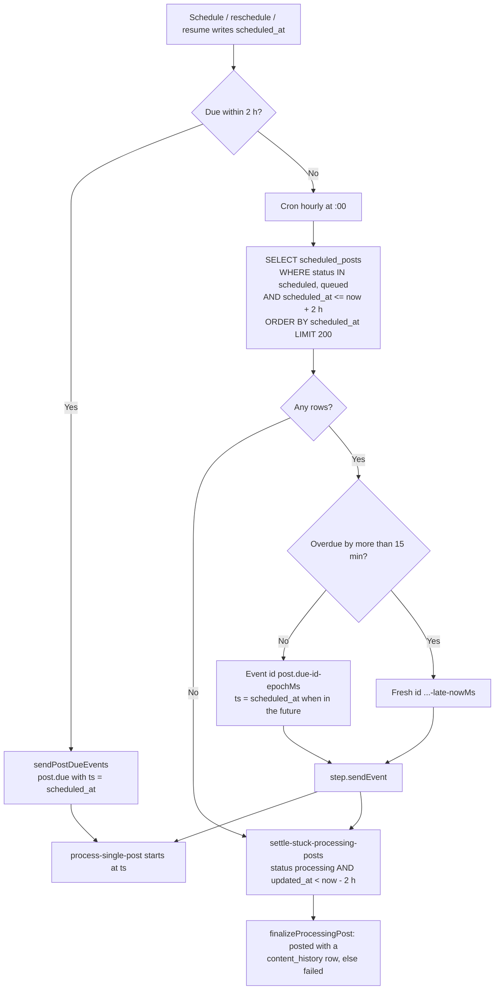
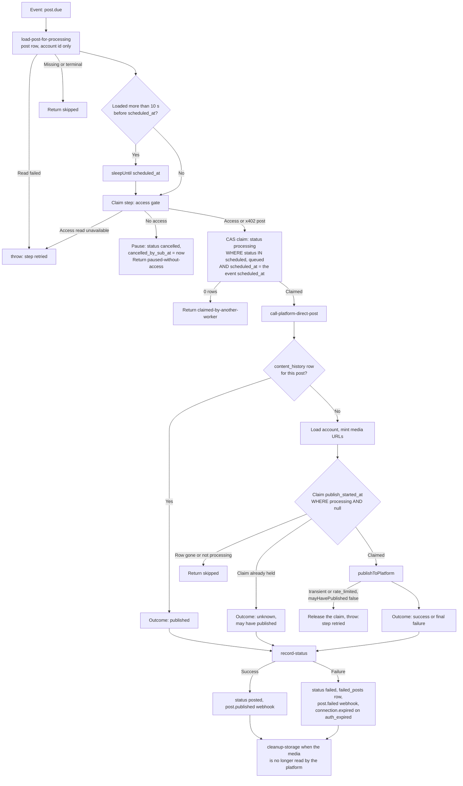
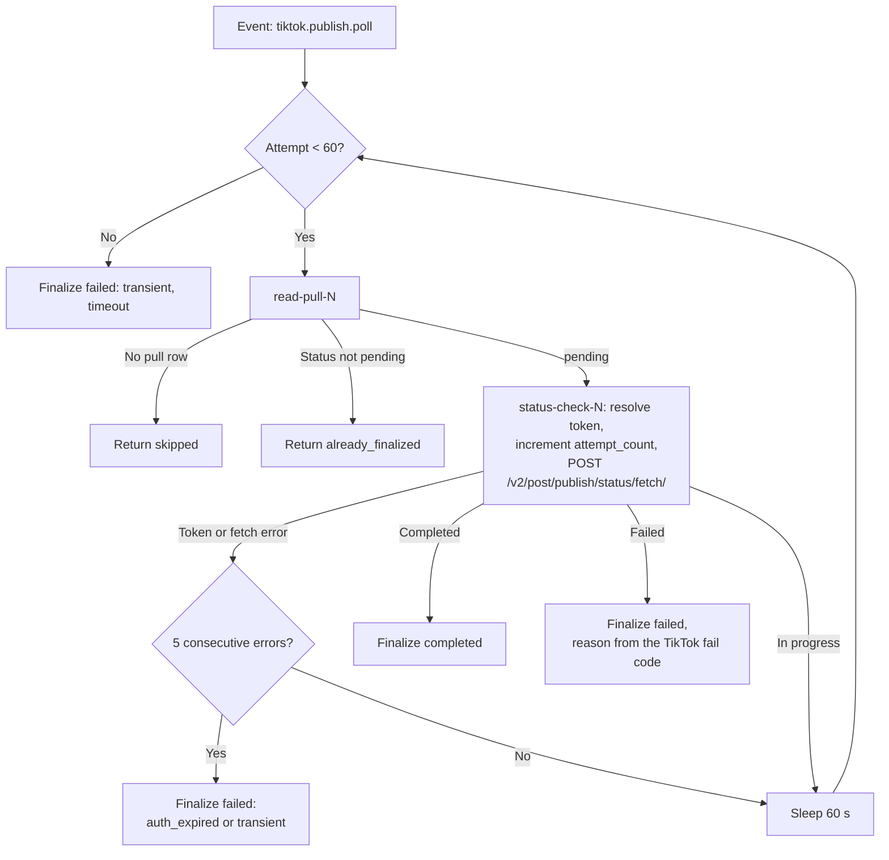
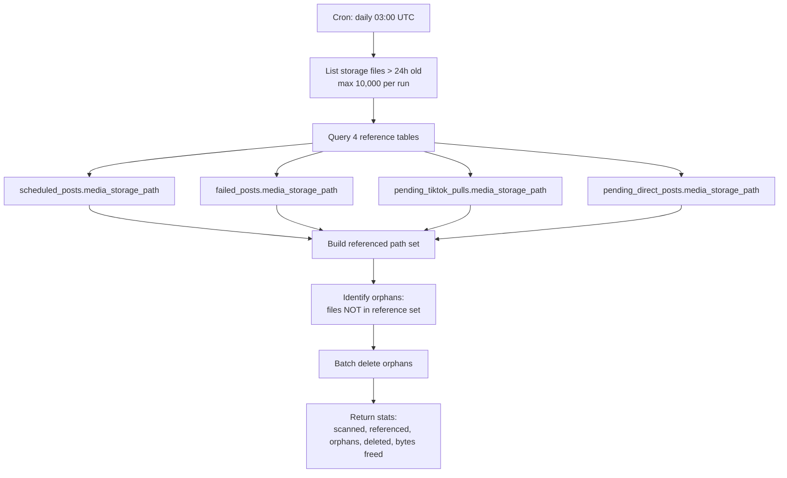
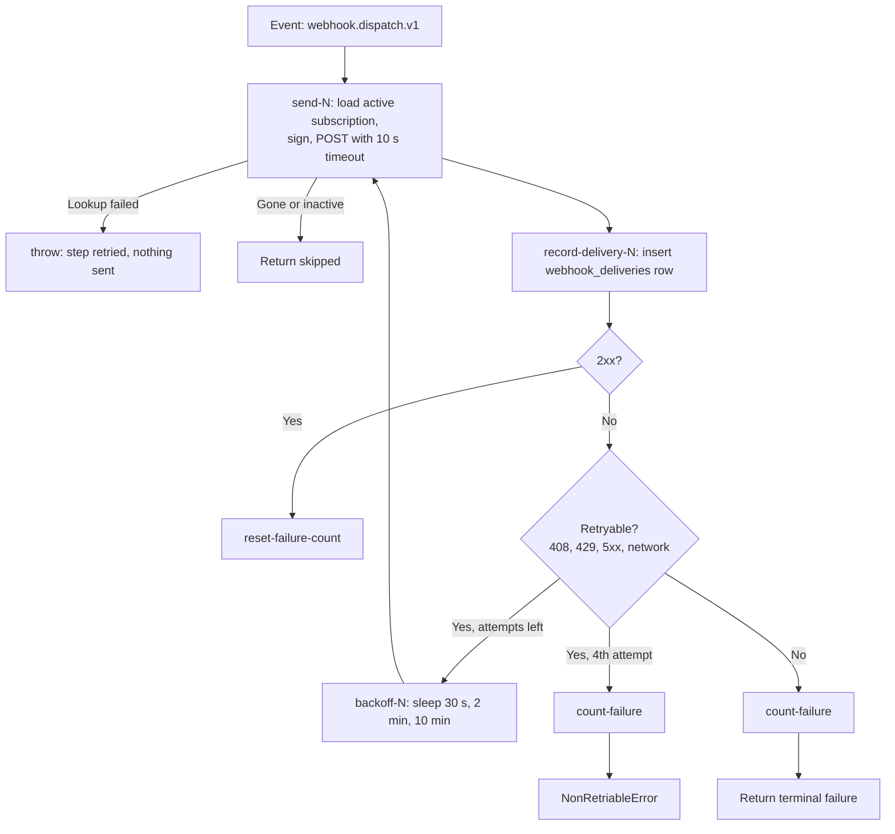

# Inngest Functions

23 background functions registered in `src/app/api/inngest/route.ts`. The Inngest client ID is `sharetopus` (`src/inngest/client.ts`).

Runtime configuration is centralized in `src/lib/jobs/runtimeConfig.ts` with env-overridable defaults tuned for Vercel Hobby (300s max function duration, ~2048 MB memory).

[Back to README](../README.md)

## Table of contents

- [Function inventory](#function-inventory)
- [Retries and steps](#retries-and-steps)
- [scheduled-posts-tick](#scheduled-posts-tick)
- [process-single-post](#process-single-post)
- [process-direct-post](#process-direct-post)
- [tiktok-publish-status-poll](#tiktok-publish-status-poll)
- [repoll-stalled-tiktok-pulls](#repoll-stalled-tiktok-pulls)
- [process-tiktok-publish-webhook](#process-tiktok-publish-webhook)
- [sweep-stuck-direct-posts](#sweep-stuck-direct-posts)
- [sweep-orphan-storage-files](#sweep-orphan-storage-files)
- [sweep-stale-oauth-clients](#sweep-stale-oauth-clients)
- [cleanup-cancelled-posts-after-grace](#cleanup-cancelled-posts-after-grace)
- [Retention crons](#retention-crons)
- [cleanup-finished-tiktok-pulls](#cleanup-finished-tiktok-pulls)
- [encrypt-plaintext-secrets](#encrypt-plaintext-secrets)
- [refresh-expiring-tokens](#refresh-expiring-tokens)
- [refresh-social-account-token](#refresh-social-account-token)
- [record-referral-signup](#record-referral-signup)
- [deliver-webhook](#deliver-webhook)
- [Event vocabulary](#event-vocabulary)
- [Runtime configuration](#runtime-configuration)
- [Cron schedule coordination](#cron-schedule-coordination)
- [Error classification](#error-classification)
- [Source files referenced](#source-files-referenced)

## Function inventory

| Function ID | Trigger | Concurrency | Retries | Purpose |
|---|---|---|---|---|
| scheduled-posts-tick | Cron `0 * * * *` | 1 | 2 | Hourly safety net: re-sends `post.due` for unclaimed posts due within 2 h, settles posts left in `processing` 2 h after their last write |
| process-single-post | Event `post.due` | 5 (dynamic) | 3 (`WORKER_MAX_RETRIES`, capped at 20) | Publish one scheduled post |
| process-direct-post | Event `post.now` | 5 (dynamic) | 3 (`WORKER_MAX_RETRIES`, capped at 20) | Publish one "post now" item |
| tiktok-publish-status-poll | Event `tiktok.publish.poll` | 5 per account | 3 | Poll TikTok until a publish completes or fails |
| repoll-stalled-tiktok-pulls | Cron `40 * * * *` | default | 2 | Re-send the poll for pending TikTok pulls nobody polled for 10 min |
| process-tiktok-publish-webhook | Event `tiktok.publish.webhook.received` | default | 3 | Handle TikTok publish webhook callbacks |
| sweep-stuck-direct-posts | Cron `15 * * * *` | default | 2 | Fail `pending_direct_posts` rows still `processing` 60 min after creation and fire `post.failed` |
| sweep-orphan-storage-files | Cron `0 3 * * *` | default | 2 | Delete unreferenced storage files (>24h) |
| sweep-stale-oauth-clients | Cron `0 4 * * *` | default | 2 | Remove unverified OAuth clients (>90 days, no activity) |
| cleanup-cancelled-posts-after-grace | Cron `0 5 * * *` | default | 2 | Resume paused posts of owners with access, delete them 7 days after the pause for owners without |
| cleanup-stripe-webhook-events | Cron `0 3 * * *` | default | 2 | Purge processed Stripe webhook events (>90 days) |
| cleanup-mcp-audit-log | Cron `0 4 * * *` | default | 2 | Delete MCP audit log rows (>90 days) |
| cleanup-x402-access-log | Cron `0 6 * * *` | default | 2 | Delete x402 access log rows (>90 days) |
| cleanup-rest-audit-log | Cron `0 7 * * *` | default | 2 | Delete REST audit log rows (>90 days) |
| cleanup-tiktok-webhook-events | Cron `0 8 * * *` | default | 2 | Purge logged TikTok webhook events (>90 days) |
| cleanup-finished-tiktok-pulls | Cron `30 8 * * *` | default | 2 | Delete finished TikTok pulls finalized more than 90 days ago |
| cleanup-social-connections | Cron `0 2 * * *` | default | 2 | Delete pending, failed and expired OAuth connection rows (>30 days) |
| sweep-x402-reconciliation | Cron `20 * * * *` | default | 2 | Resolve or report x402 payments that need a manual look |
| encrypt-plaintext-secrets | Cron `0 9 * * *`, Event `secrets.encrypt-plaintext` | default | 1 | Encrypt social account tokens, webhook secrets and share-link tokens still stored in plaintext |
| refresh-expiring-tokens | Cron `0 1 * * *` | default | 2 | Request a refresh for every account whose token expires within 7 days |
| refresh-social-account-token | Event `social-account.token.refresh` | 5 | 3 | Refresh one account's token, or flag it for reconnect |
| deliver-webhook | Event `webhook.dispatch.v1` | default | 3 per step | Deliver one webhook event to a subscriber (HMAC signed) |
| record-referral-signup | Event `referral.signup` | default | 3 | Record a referred signup and grant the referrer's reward |

## Retries and steps

Inngest stores the result of every completed step and retries only a step that throws (https://www.inngest.com/docs/learn/how-functions-are-executed, https://www.inngest.com/docs/guides/error-handling). The functions follow three rules from that:

- A step that should be retried throws inside itself. A failed read or write is never returned as an error value from a completed step, since Inngest would show a green run and never retry it. This is the one documented exception to errors as values in this codebase.
- No step returns an OAuth token or a secret. A step that needs the account row loads it itself (`fetchAccountForPublish`) and returns only what the next step needs.
- A step that publishes checks first whether an earlier attempt already published (the publish guard). process-single-post also claims the attempt in the database right before the platform call (`publish_started_at`), so a retry after a killed attempt never calls the platform a second time.

A function whose last error should not be retried throws `NonRetriableError` (sweep-orphan-storage-files after a failed folder listing, sweep-x402-reconciliation when open items remain, deliver-webhook after its last POST).

## scheduled-posts-tick

**File:** `src/inngest/functions/scheduledPostsTick.ts`
**Schedule:** Hourly at :00
**Concurrency:** 1
**Retries:** 2
**Batch size:** `RUNTIME.dispatcherBatchSize` (200)

Each scheduled post fires at its own time: every writer of `scheduled_posts.scheduled_at` (schedule, reschedule, resume, resume on resubscribe) calls `sendPostDueEvents` (`src/inngest/dispatch/sendPostDueEvents.ts`), which sends `post.due` with a future `ts` for each post due within 2 hours (`POST_DUE_LOOKAHEAD_MS`). Inngest starts the run at that `ts`. A post due later than 2 hours gets no event at write time; the hourly tick sends it once it enters the window.

The tick is the safety net. It reads unclaimed posts (`status` in `scheduled`, `queued`) due within 2 hours, oldest first, and plans one event per post with `planPostDueEvents` (`src/inngest/events/postDue.ts`):

- On time (due in the future, or overdue by less than 15 minutes, `POST_DUE_OVERDUE_GRACE_MS`): id `post.due-{postId}-{scheduledAtEpochMs}`. Inngest drops a repeated id for 24 hours, so a post whose event is already pending gets no second run.
- Late (overdue by more than 15 minutes): id `post.due-{postId}-{scheduledAtEpochMs}-late-{nowMs}`, a fresh id, because the on-time event may already be spent. The tick logs each late post.

A failed send in a writer is logged and the post waits for the next tick, so a post can fire up to about an hour late when Inngest refused the send.

The step that reads the rows also stores `nowMs`, so a retry of the send step reuses the same event ids. The tick never claims a post: the state moves from `scheduled` to `processing` only in the worker's claim. `queued` is a legacy state, still read and claimable, never written.

The last step, `settle-stuck-processing-posts`, runs even when no post is due. It reads `processing` rows whose `updated_at` is more than 2 hours old (`STUCK_PROCESSING_AGE_MS`, oldest first, 200 at most) and settles each with `finalizeProcessingPost`: `posted` when a `content_history` row exists, else `failed` with "Publishing stopped without a result; the post may have published". The `on_scheduled_posts_update` trigger sets `updated_at` on every UPDATE, so the claim to `processing`, the publish claim and its release all restart that clock. The settle's own write also requires `publish_started_at` to be null or older than the same 2 h cutoff, so a run that claimed its attempt after the read keeps the post. The step tries every row, then throws if any failed, so Inngest retries it.

## process-single-post

**File:** `src/inngest/functions/processSinglePost.ts` (helpers in `processSinglePostHelpers.ts`)
**Trigger:** Event `post.due` (`src/inngest/events/postDue.ts`)
**Concurrency:** `RUNTIME.workerConcurrency` (5, computed from memory)
**Retries:** `toInngestRetryCount(RUNTIME.maxRetries)` (default 3, clamped to 0 through 20)
**Throttle:** `RUNTIME.perAccountThrottlePerMinute` (5) per `social_account_id`
**onFailure:** `finalizeExhaustedPost`

Steps, in order:

1. `load-post-for-processing` reads the post and checks that its account exists (id only, `loadPostForProcessing`). A failed read throws. A missing or already terminal post (`posted`, `failed`, `cancelled`) ends the run.
2. When the run starts more than 10 s before `scheduled_at` (a late safety-net event can arrive early, or Inngest starts a run early), `wait-until-scheduled-time` sleeps until the post's time.
3. The claim step runs the publish-time access gate (`gatePostOnOwnerAccess`), then the claim. Posts created through x402 skip the gate (`needsOwnerAccessToPublish`). For every other post the gate reads `checkActiveSubscription`: an unreadable state throws (the step is retried and the post stays unclaimed, never published on an unknown); no access pauses the post exactly like a lost subscription (`status = 'cancelled'`, `cancelled_by_sub_at = now`, `buildAccessPauseValues`). With access, `claimPostForProcessing` moves the post to `processing` with a compare-and-set on its id, a waiting status and the event's `scheduled_at`, so an event for a post rescheduled since dispatch claims nothing. A missing account or a platform that refuses the media type still passes through the gate and the claim, then records `invalid_input`.
4. `call-platform-direct-post` first checks `content_history` for a row with this post's id (the publish guard). Without one it loads the account with its tokens (`fetchAccountForPublish`) and mints the media URLs inside the step (`mintPublishMediaUrls`). A media file that no longer exists fails the post as `invalid_input`. Right before the call, `claimPublishAttempt` sets `publish_started_at` where the post is `processing` and the column is null. When that matches no row it rereads the row: gone or no longer `processing` returns `skipped` with no call; still `processing` means an earlier attempt holds the claim, so the step returns `unknown` with `mayHavePublished: true` ("An earlier publish attempt stopped before it reported a result; the post may have published") and never calls the platform. After a claim, `publishToPlatform` runs. A `transient` or `rate_limited` failure with `mayHavePublished: false` clears the claim (`releasePublishAttempt`) and throws, so Inngest retries the step; every other failure is final.
5. `record-status` writes `posted` or `failed` with a guard on `status = 'processing'` (`recordPostStatus`), stores the `failed_posts` row, and fires the webhooks.
6. `cleanup-storage` deletes the media when nothing else references it (`cleanupMediaIfUnreferenced`). It is skipped when the post may be live on TikTok (the TikTok finalize cleans up after the pull settles) or on a platform that hotlinks our URL (`shouldDeleteMediaAfterPublish`).

When every retry fails, `finalizeExhaustedPost` claims the post if it is not yet `processing`, checks the publish guard, and records `posted` when a `content_history` row exists, `failed` (`transient`, "Retries exhausted") otherwise. Its write requires `publish_started_at` to be null, so it never settles a post whose attempt may still be calling the platform (the failure event can come from a second run that never claimed the post); the hourly safety net settles such a post 2 h later. A failed read or write throws, and Inngest runs `onFailure` once more.

Platform compatibility comes from the capability catalog (`platformSupportsMediaType` in `src/lib/platforms/capabilities.ts`).

Media URLs (`mintPublishMediaUrls` in `publishToPlatform.ts`): Pinterest, Instagram, Facebook and registry platforms get a Supabase signed URL, valid `SIGNED_URL_TTL_S` (300 s) or 30 days for platforms that hotlink the URL. TikTok gets an HMAC-signed proxy URL or a direct Supabase URL depending on `TIKTOK_MEDIA_SOURCE`. LinkedIn, YouTube and X upload the bytes and need no URL.

## process-direct-post

**File:** `src/inngest/functions/processDirectPost.ts` (helpers in `processDirectPostHelpers.ts`)
**Trigger:** Event `post.now` (`src/inngest/events/postNow.ts`)
**Concurrency:** `RUNTIME.workerConcurrency` (5)
**Retries:** `toInngestRetryCount(RUNTIME.maxRetries)` (default 3)
**Throttle:** `RUNTIME.perAccountThrottlePerMinute` (5) per `social_account_id`
**onFailure:** `finalizeExhaustedDirectPost`

`dispatchPostNowEvents` (`src/inngest/dispatch/dispatchPostNowEvents.ts`) validates each payload against `PostNowEventDataSchema` and refuses only the invalid ones, inserts one `pending_direct_posts` lock per valid post, and sends the events with id `post.now-{dispatch_id}`. When `inngest.send` fails it releases the locks it just inserted that no run has claimed yet (`publish_started_at` null), so the user can post again.

The worker runs up to four steps:

1. `call-platform-direct-post` reads the dispatch row (`readDirectDispatch`). No row ends the run with `invalid_input`. On a retry (`attempt > 0`) it checks `content_history` for a row with the same batch id, account, platform and description created after the dispatch (`findPublishedDirectPost`); a match counts as published. Then it loads the account, mints the media URLs and, right before the call, claims the attempt: `claimDirectPublishAttempt` sets `publish_started_at` where the row is `processing` and the column is null. When that matches no row, the reread decides: `completed` counts as published; a held claim returns `unknown` with `mayHavePublished: true` ("An earlier publish attempt stopped before it reported a result; the post may have published") and never calls the platform; `failed` with no claim returns "Not published: the post was already marked failed". After a claim, `publishToPlatform` runs. A `transient` or `rate_limited` failure with `mayHavePublished: false` clears the claim (`releaseDirectPublishAttempt`) and throws, so Inngest retries the step; every other failure is final.
2. `finalize-pending-direct-post` marks the row `completed` or `failed` (`finalizePendingDirectPost`, a compare-and-set on `processing`, or on a row an older sweep marked `stale_worker_swept`); a failed write throws and is retried. When the write matches no row it rereads the row: a row that holds this run's status counts as recorded (an earlier attempt's write whose reply was lost), unless it holds the sweep's record.
3. `notify-post-outcome` runs only when step 2 recorded the outcome. It fires `post.published` or `post.failed`, plus `connection.expired` when the failure is `auth_expired` (payloads in [WEBHOOKS.md](./WEBHOOKS.md#payloads)).
4. `cleanup-media` deletes the media under the same rule as process-single-post.

When every retry fails, `finalizeExhaustedDirectPost` reads the row. A row gone or `completed` ends it. Otherwise it records `completed` when `content_history` has the post, else `failed` with "Retries exhausted: <last error>", plus the may-have-published sentence and `mayHavePublished: true` when the claim is held. When its write updated the row it fires the same webhooks as step 3, then cleans up media that is safe to delete.

## tiktok-publish-status-poll

**File:** `src/inngest/functions/tikTokPublishStatusPoll.ts` (finalize steps in `tikTokPullFinalizeSteps.ts`)
**Trigger:** Event `tiktok.publish.poll` (schema `tikTokPublishPollEvent` in `src/inngest/events/tikTokPublishPoll.ts`)
**Concurrency:** 5 per `social_account_id`
**Retries:** 3
**onFailure:** `finalizeAbandonedPoll` finalizes the pull as failed (`transient`, "Status polling stopped")

The TikTok adapter (`directPostForTikTokAccounts`) sends the first poll with id `tiktok-poll-{publishId}`, so a repeated send starts no second poller.

Finalizing runs `finalizeTikTokPostByPublishId` in its own step, in one transaction. Only the first writer moves the pull out of `pending`, so the poll and the webhook can both try. The winner updates `content_history`; on a failure it also moves a linked scheduled post from `processing` or `posted` to `failed`, or, for a publish-now pull, its dispatch from `processing` or `completed` to `failed`. A publish-now pull names its dispatch in `dispatch_id` (`directPostForTikTokAccounts` writes it from the post-now origin). A pull written before that column existed has none: `findDispatchOfLegacyPull` reads the batch of the pull's `content_history` row and takes the one dispatch with that batch, account, platform `tiktok` and media path; when two match, neither changes. Then two more steps run: `-cleanup-media` deletes the media when nothing references it, and `-notify-post-failed` fires `post.failed` with `may_have_published: false` for the scheduled post or dispatch the failure reached. A TikTok success never moves a failed post or dispatch.

**Polling config:**
- Max attempts: `RUNTIME.tikTokPublishPollMaxAttempts` (60)
- Interval: `RUNTIME.tikTokPublishPollIntervalMs` (60,000ms = 60 seconds)
- Total ceiling: ~60 minutes (matches TikTok's 1-hour URL download timeout)
- Consecutive error threshold: 5 (token resolution or status fetch errors)
- Early exit: reads the pull before each attempt and stops when it is no longer `pending`

## repoll-stalled-tiktok-pulls

**File:** `src/inngest/functions/repollStalledTikTokPullsCron.ts`
**Schedule:** Hourly at :40
**Retries:** 2
**Limit:** 500 pulls per run

Finds `pending_tiktok_pulls` rows still `pending`, created more than 10 minutes ago, and not polled for 10 minutes (`last_polled_at` null or older), and re-sends `tiktok.publish.poll` for each with id `tiktok-repoll-{publish_id}-{UTC hour}` (`buildTikTokRepollEvents`). A pull whose first poll was never sent, or whose poll run died, is polled again within the hour.

## process-tiktok-publish-webhook

**File:** `src/inngest/functions/processTikTokPublishWebhook.ts`
**Trigger:** Event `tiktok.publish.webhook.received`
**Retries:** 3

Handles TikTok publish lifecycle webhooks sent to `/api/webhooks/tiktok/publish`. The route sends each event with its derived event id as the Inngest event `id`, then logs it in `tiktok_webhook_events`; a failed send answers 500 so TikTok redelivers, and a redelivery before the log is written starts no second run. Only processes `DIRECT_POST` events (`INBOX_SHARE` is filtered out). Finalization goes through the same `finalizeTikTokPullInSteps` as the poll worker, so both can attempt to finalize without conflict.

**Events handled:**

| TikTok Event | Action |
|---|---|
| `post.publish.complete` | Finalize as completed (no `post_id` available yet) |
| `post.publish.publicly_available` | Finalize as completed with `post_id`, or backfill the `post_id` on a pull already completed |
| `post.publish.failed` | Finalize as failed |
| `inbox_delivered` | Ignored |
| `no_longer_publicly_available` | Ignored |
| `authorization.removed` | Ignored |

When the webhook finalizes a post before the poll worker reaches it, the poll worker detects the non-pending status and exits early.

## sweep-stuck-direct-posts

**File:** `src/inngest/functions/sweepStuckDirectPosts.ts`
**Schedule:** Hourly at :15
**Retries:** 2
**Cutoff:** 60 minutes (`STUCK_AGE_MS`)

Recovers `pending_direct_posts` rows whose worker died (OOM, Vercel timeout, Inngest abort) without recording them, in three steps:

1. `find-stuck-dispatches` selects up to 500 rows with `status = 'processing'`, `created_at` older than 60 minutes, and `publish_started_at` null or also older than 60 minutes (`findStuckPendingDirectPosts`). A newer claim belongs to an attempt that may still be calling the platform (Vercel stops a function after 300 s), so the sweep leaves it. The step stores the ids, the cutoff and the sweep time.
2. `mark-stuck-dispatches-failed` sets those rows that are still stuck to `failed` with `failure_reason` "Publishing stopped without a result; the post may have published" and `finished_at` set to the sweep time, then rereads the ids that hold this sweep's record, with their `publish_started_at` (`sweepStuckPendingDirectPosts`). A retry after a write whose reply was lost returns the same rows, so no webhook is lost or repeated.
3. `notify-swept-dispatches` fires `post.failed` for each swept row with `reason: "unknown"`, one `dispatchWebhooks` call per principal. A row with a claim gets `may_have_published: true`; a row with none gets `may_have_published: false` and the message "Publishing never started before the hourly sweep; the post was not published", since the claim is taken right before the platform call and cleared only after a safe try-later.

The sweep's record is final: `finalizePendingDirectPost` overwrites only `processing` rows (and rows an older sweep marked `stale_worker_swept`), so a run that ends later records nothing and fires nothing, as with a swept scheduled post. The age counts from `created_at`, not from when a worker started, so a run throttled for more than an hour before its claim finds its row failed and never publishes.

## sweep-orphan-storage-files

**File:** `src/inngest/functions/sweepOrphanStorageFiles.ts`
**Schedule:** Daily at 03:00 UTC
**Retries:** 2
**Cutoff:** 24 hours
**Max files per run:** 10,000

The whole sweep is one step that returns counts only, since a list of paths in a step result would be stored and replayed. A failed list, reference read or delete throws and the step is retried.

**Why `content_history.media_url` is excluded:** Content history stores platform-hosted URLs (e.g., `https://media.licdn.com/...`), not Supabase storage paths. Including it would never match.

**Partial success:** Failed batch deletes are counted and do not abort the run. When a folder listing failed, the run ends with `NonRetriableError` after deleting what it could, so the failure is visible; the 24-hour cutoff keeps the unchecked files eligible for the next run.

**Bucket:** `MEDIA_BUCKET` (`src/lib/storage/mediaBucket.ts`): `SUPABASE_BUCKET_NAME` when set, `scheduled-videos` otherwise.

## sweep-stale-oauth-clients

**File:** `src/inngest/functions/sweepStaleOauthClientsCron.ts`
**Schedule:** Daily at 04:00 UTC
**Retries:** 2
**Retention:** `RETENTION_DAYS` = 90

Removes unverified OAuth clients created more than 90 days ago that have no `mcp_audit_log` row in that window, at most 1,000 per run. This prevents accumulation of abandoned MCP client registrations.

## cleanup-cancelled-posts-after-grace

**File:** `src/inngest/functions/cleanupCancelledPostsAfterGraceCron.ts` (logic in `src/actions/server/data/cleanupCancelledPostsAfterGrace.ts`)
**Schedule:** Daily at 05:00 UTC
**Retries:** 2
**Grace period:** 7 days after the pause

Reads up to 500 principals that own posts paused by access loss (`status = 'cancelled'` with `cancelled_by_sub_at` set), oldest pause first, and checks their access in one batch (`findPrincipalsWithAccess`):

- A principal with access (a subscription or referral weeks, whatever the age of the pause) gets `resumeCancelledPostsOnResubscribe`: the posts go back to `scheduled`, past times move one hour ahead, and `post.due` is sent. This is how posts come back when referral weeks are granted again, since no Stripe event fires then.
- A principal without access loses the posts paused more than 7 days ago.

A failed access read or a failed delete fails the step. A failed resume for one principal does not stop the others, but the run then fails so it is retried.

## Retention crons

Five crons delete rows older than `RETENTION_DAYS` = 90 (`src/lib/jobs/retention.ts`) through `deleteExpiredRows` (`src/lib/jobs/deleteExpiredRows.ts`). Each has one step and `Retries: 2`; a failed DELETE throws.

| Function | File | Schedule (UTC) | Table and filter |
|---|---|---|---|
| cleanup-stripe-webhook-events | `cleanupStripeWebhookEvents.ts` | 03:00 | `stripe_webhook_events.processed_at` |
| cleanup-mcp-audit-log | `cleanupMcpAuditLogCron.ts` | 04:00 | `mcp_audit_log`: `month <= cutoffMonth AND created_at < cutoff` |
| cleanup-x402-access-log | `cleanupX402AccessLogCron.ts` | 06:00 | `x402_access_log`: `month <= cutoffMonth AND created_at < cutoff` |
| cleanup-rest-audit-log | `cleanupRestAuditLogCron.ts` | 07:00 | `rest_audit_log.created_at` |
| cleanup-tiktok-webhook-events | `cleanupTikTokWebhookEventsCron.ts` | 08:00 | `tiktok_webhook_events.processed_at` |

The MCP and x402 deletes filter on the indexed generated `month` column first, then on `created_at`, so the result is exact and the scan uses the index.

`mcp_audit_log` and `x402_access_log` carry the `reject_mutation` trigger, which refuses every UPDATE and DELETE, and no database role bypasses a trigger. `deleteFromAppendOnlyTable` runs their DELETE in its own transaction that first calls `set_config('app.allow_append_only_delete', 'on', true)`: the one exception the trigger allows, local to that transaction. `rest_audit_log` is append-only by convention and has no trigger, so a plain DELETE goes through.

`tiktok_webhook_events` deduplicates TikTok redeliveries, so it must outlive TikTok's 72-hour redelivery window; 90 days does.

Stripe webhook event records exist for idempotency checking; Stripe retries an event for up to three days.

## cleanup-finished-tiktok-pulls

**File:** `src/inngest/functions/cleanupFinishedTikTokPullsCron.ts`
**Schedule:** Daily at 08:30 UTC
**Retries:** 2
**Retention:** `RETENTION_DAYS` = 90

Deletes `pending_tiktok_pulls` rows that are no longer `pending`, were finalized more than 90 days ago, and no scheduled post references (`scheduled_post_id` null).

## encrypt-plaintext-secrets

**File:** `src/inngest/functions/encryptPlaintextSecretsCron.ts`
**Schedule:** Daily at 09:00 UTC, and on the `secrets.encrypt-plaintext` event
**Retries:** 1
**Batch:** `BATCH_SIZE` = 500 rows per column per run

Rewrites every value still stored in plaintext through its encrypting column (see [SECURITY.md](./SECURITY.md#tokens-and-secrets-at-rest)), in one step per encrypted column, 4 steps (`PLAINTEXT_COLUMN_PASSES`): `social_accounts.access_token`, `social_accounts.refresh_token`, `webhook_subscriptions.secret` and `share_links.token`. The share-link step also writes `token_hash`, so a link created before hashing shipped stays reachable. After the deploy that ships encryption, send `secrets.encrypt-plaintext` from the Inngest dashboard to encrypt the existing rows at once instead of waiting for 09:00. It runs inside the deployment on purpose: a backfill run from a laptop with a different key would leave every token unreadable.

Each row update is guarded on the stored value it read, so a token refreshed meanwhile (already encrypted by its own write) is left alone. Each step returns counts only, since Inngest stores step results. A failed row update fails the step after the other rows are tried. Once every row is encrypted, a run is four queries that find nothing; the job also catches a row written in plaintext by an instance still running the old code during the rollout.

## refresh-expiring-tokens

**File:** `src/inngest/functions/refreshExpiringTokensCron.ts`
**Schedule:** Daily at 01:00 UTC
**Retries:** 2
**Limit:** 1,000 accounts per run

Selects available, not deleted accounts on a refreshable platform (the 7 adapter platforms plus the registry providers with a refresh, `listRefreshablePlatformIds`) whose `token_expires_at` falls within 7 days (`TOKEN_REFRESH_HORIZON_MS`), soonest first, and sends one `social-account.token.refresh` per account with id `token-refresh-{accountId}-{UTC day}`. A second send on the same day is dropped. Refreshing a week ahead matters for tokens that cannot be refreshed once expired (Instagram, Threads).

## refresh-social-account-token

**File:** `src/inngest/functions/refreshSocialAccountToken.ts`
**Trigger:** Event `social-account.token.refresh` (`src/inngest/events/socialAccountTokenRefresh.ts`)
**Concurrency:** 5
**Retries:** 3

One step re-reads the account and refreshes it through the same path publishing uses, with a 7-day window: `ensureValidToken(account, { refreshIfExpiringWithinMs: TOKEN_REFRESH_HORIZON_MS })` for adapter platforms, `refreshRegistryAccountToken` for registry providers. Outcomes:

| Outcome | Meaning |
|---|---|
| `refreshed` | A new token was saved |
| `needs_reconnect` | The platform refused the refresh (`auth_expired`): `settleRefusedRefresh` flags the account `is_available = false`, unless another run saved a new token meanwhile. Also returned when a registry provider rotated its refresh token and the new one could not be saved; that account stays available until its token expires |
| `not_due` | The token expires more than 7 days out |
| `skipped` | The account is deleted (`account_gone`) or already unavailable (`already_unavailable`) |

A `transient` failure throws and is retried.

## record-referral-signup

**File:** `src/inngest/functions/recordReferralSignup.ts`
**Trigger:** Event `referral.signup` (`src/inngest/events/referralSignup.ts`)
**Retries:** 3

`ensureUserExists` sends the event in `after()` when a new user arrives with a valid referral cookie, with id `referral-signup-{userId}`. Two steps:

1. `record-referral` runs `recordReferralOnSignup`. Any outcome other than `recorded` ends the run; a failure throws.
2. `grant-referral-rewards` runs `triggerReferralGrant` for the referrer; a failure throws and the step is retried.

## deliver-webhook

**File:** `src/inngest/functions/deliverWebhook.ts`
**Trigger:** Event `webhook.dispatch.v1` (`src/inngest/events/webhookDispatch.ts`)
**Retries:** 3 per step (`DB_STEP_RETRIES`), for the database reads and writes
**Throttle:** 100 per 60s per `subscription_id`

Delivers a single webhook event to one subscriber endpoint. Each side effect is its own step, so a failed log or counter write is retried without sending the POST again. Each POST attempt has its own step id (`send-1`, `send-2`, ...), and the waits between attempts are `step.sleep` calls of 30 s, 2 min and 10 min (`RETRY_DELAYS_BEFORE_NEXT_ATTEMPT`), so an endpoint gets at most 4 POSTs per event.

Headers sent: `X-Sharetopus-Event`, `X-Sharetopus-Delivery`, `X-Sharetopus-Signature` (`sha256=<hex>`), `User-Agent: Sharetopus-Webhook/1.0`.

Auto-disable threshold: 10 failed deliveries in a row (`AUTO_DISABLE_THRESHOLD`). `failure_count` grows by one per failed delivery (after its last attempt), not per POST. The increment is one UPDATE computed from the stored count, and it never re-enables a subscription the user disabled. Re-enabling via PATCH `/api/v1/webhooks/:id` resets `failure_count` to 0.

A delivery log row whose subscription was deleted mid-delivery is skipped (foreign key violation). Delivery is at least once: a POST whose step result was lost is sent again with a new delivery id, so receivers deduplicate on `event_id`.

## Event vocabulary

| Event Name | Emitted By | Consumed By | Payload Key Fields |
|---|---|---|---|
| `post.due` | `sendPostDueEvents` (schedule, reschedule, resume, resume on resubscribe), scheduled-posts-tick | process-single-post | `scheduled_post_id`, `principal_id`, `social_account_id`, `platform`, `scheduled_at` |
| `post.now` | `dispatchPostNowEvents` (called by `directPostBatch`) | process-direct-post | `dispatch_id`, `batch_id`, account, content, `platform_options`, `media_path`, `created_via` (`PostNowEventDataSchema`) |
| `tiktok.publish.poll` | TikTok adapter (`directPostForTikTokAccounts`), repoll-stalled-tiktok-pulls | tiktok-publish-status-poll | `publish_id`, `social_account_id` |
| `tiktok.publish.webhook.received` | `/api/webhooks/tiktok/publish` (route handler) | process-tiktok-publish-webhook | TikTok event type, `content` (publish id, post id) |
| `webhook.dispatch.v1` | `dispatchWebhook`, `dispatchWebhooks`, `sendWebhookDispatchEvent` (`src/lib/api/rest/webhooks/dispatch.ts`) | deliver-webhook | `subscription_id`, `event_type`, `event_id`, `payload` |
| `social-account.token.refresh` | refresh-expiring-tokens | refresh-social-account-token | `social_account_id` |
| `referral.signup` | `ensureUserExists` | record-referral-signup | `new_user_id`, `referral_code` |
| `secrets.encrypt-plaintext` | Sent by hand from the Inngest dashboard | encrypt-plaintext-secrets | none |

Every event with a schema is declared with `eventType` in `src/inngest/events/`, so `inngest.send` validates the payload and the worker's `event.data` is typed. The stored `scheduled_posts.post_options` shape is `src/inngest/events/postOptions.ts`.

## Runtime configuration

`src/lib/jobs/runtimeConfig.ts` exports a `RUNTIME` object with defaults tuned for Vercel Hobby:

| Setting | Default | Env Override |
|---|---|---|
| maxDurationS | 300 (equals `maxDuration` in `src/app/api/inngest/route.ts`; `runtimeConfig.test.ts` checks it) | |
| minStepBudgetS | 290 (the client sets `checkpointing.maxRuntime` to `maxDurationS - minStepBudgetS`, 10 s, so every step starts with at least 290 s left) | |
| workerConcurrency | 5 (auto-computed: `floor(VERCEL_INSTANCE_MEMORY_MB / (maxVideoMB + 100))` = `floor(2048/350)`) | `VERCEL_INSTANCE_MEMORY_MB` (default 2048) |
| maxVideoMB | 250 (largest tier video limit in `uploadLimits.ts`) | |
| perAccountThrottlePerMinute | 5 | `PER_ACCOUNT_THROTTLE_PER_MIN` |
| maxRetries | 3 | `WORKER_MAX_RETRIES` |
| dispatcherBatchSize | 200 | `DISPATCHER_BATCH_SIZE` |
| signedUrlTtlS | 300 | `SIGNED_URL_TTL_S` |
| tikTokPublishPollMaxAttempts | 60 | |
| tikTokPublishPollIntervalMs | 60,000 (60 seconds) | |

## Cron schedule coordination

All cron times are UTC. Functions at the same time slot run in parallel (no ordering dependency between them).

| UTC Time | Functions |
|---|---|
| `0 * * * *` (hourly at :00) | scheduled-posts-tick |
| `15 * * * *` (hourly at :15) | sweep-stuck-direct-posts |
| `20 * * * *` (hourly at :20) | sweep-x402-reconciliation |
| `40 * * * *` (hourly at :40) | repoll-stalled-tiktok-pulls |
| `0 1 * * *` (01:00) | refresh-expiring-tokens |
| `0 2 * * *` (02:00) | cleanup-social-connections |
| `0 3 * * *` (03:00) | sweep-orphan-storage-files, cleanup-stripe-webhook-events |
| `0 4 * * *` (04:00) | sweep-stale-oauth-clients, cleanup-mcp-audit-log |
| `0 5 * * *` (05:00) | cleanup-cancelled-posts-after-grace |
| `0 6 * * *` (06:00) | cleanup-x402-access-log |
| `0 7 * * *` (07:00) | cleanup-rest-audit-log |
| `0 8 * * *` (08:00) | cleanup-tiktok-webhook-events |
| `30 8 * * *` (08:30) | cleanup-finished-tiktok-pulls |
| `0 9 * * *` (09:00) | encrypt-plaintext-secrets |

## Error classification

Both post workers publish through `publishToPlatform` (`src/inngest/functions/publishToPlatform.ts`). The 7 adapter platforms return a `DirectPostScheduleResult` and the registry providers a `RegistryPublishOutcome`; both carry a typed `failure: { reason, mayHavePublished }` with `reason` a `PlatformFailureReason` (`src/lib/api/_shared/platformFailure.ts`), classified from the platform's own error codes. `isSafeToRetryPost` in `src/inngest/functions/platformErrors.ts` decides:

- **Retried:** `rate_limited` and `transient`, only when `mayHavePublished` is false (the worker throws inside the publish step, Inngest retries with backoff).
- **Final:** `auth_expired`, `policy_rejected`, `invalid_input`, `unknown`, and any failure with `mayHavePublished: true`, since a retry could post twice.

An adapter that published but could not record a side effect (content history, TikTok pull row, TikTok poll event) returns `warnings`, which `publishToPlatform` logs with the `[publishToPlatform]` prefix.

---

**See also:** [docs/SCHEDULING.md](./SCHEDULING.md) (post lifecycle, lock tables), [docs/STORAGE.md](./STORAGE.md) (orphan sweep details), [docs/PLATFORMS.md](./PLATFORMS.md) (per-platform posting flows)

[Back to README](../README.md)

## Source files referenced

- `src/inngest/client.ts` (Inngest client, ID: "sharetopus")
- `src/app/api/inngest/route.ts` (function registration, 23 functions)
- `src/lib/jobs/runtimeConfig.ts` (RUNTIME config object)
- `src/lib/jobs/retention.ts`, `src/lib/jobs/deleteExpiredRows.ts` (retention rule and deletes)
- `src/inngest/events/` (`postDue.ts`, `postNow.ts`, `postOptions.ts`, `tikTokPublishPoll.ts`, `socialAccountTokenRefresh.ts`, `referralSignup.ts`, `webhookDispatch.ts`)
- `src/inngest/dispatch/sendPostDueEvents.ts`, `src/inngest/dispatch/dispatchPostNowEvents.ts`
- `src/inngest/functions/scheduledPostsTick.ts`
- `src/inngest/functions/processSinglePost.ts`
- `src/inngest/functions/processDirectPost.ts`
- `src/inngest/functions/publishToPlatform.ts`
- `src/inngest/functions/tikTokPublishStatusPoll.ts`
- `src/inngest/functions/tikTokPullFinalizeSteps.ts`
- `src/inngest/functions/repollStalledTikTokPullsCron.ts`
- `src/inngest/functions/processTikTokPublishWebhook.ts`
- `src/inngest/functions/sweepStuckDirectPosts.ts`
- `src/inngest/functions/sweepOrphanStorageFiles.ts`
- `src/inngest/functions/sweepStaleOauthClientsCron.ts`
- `src/inngest/functions/cleanupCancelledPostsAfterGraceCron.ts`
- `src/inngest/functions/cleanupStripeWebhookEvents.ts`
- `src/inngest/functions/cleanupMcpAuditLogCron.ts`
- `src/inngest/functions/cleanupX402AccessLogCron.ts`
- `src/inngest/functions/cleanupRestAuditLogCron.ts`
- `src/inngest/functions/cleanupTikTokWebhookEventsCron.ts`
- `src/inngest/functions/cleanupFinishedTikTokPullsCron.ts`
- `src/inngest/functions/cleanupSocialConnectionsCron.ts`
- `src/inngest/functions/sweepX402ReconciliationCron.ts`
- `src/inngest/functions/encryptPlaintextSecretsCron.ts`
- `src/inngest/functions/refreshExpiringTokensCron.ts`
- `src/inngest/functions/refreshSocialAccountToken.ts`
- `src/inngest/functions/recordReferralSignup.ts`
- `src/inngest/functions/deliverWebhook.ts`
- `src/inngest/functions/platformErrors.ts`
- `src/lib/api/rest/webhooks/dispatch.ts`
