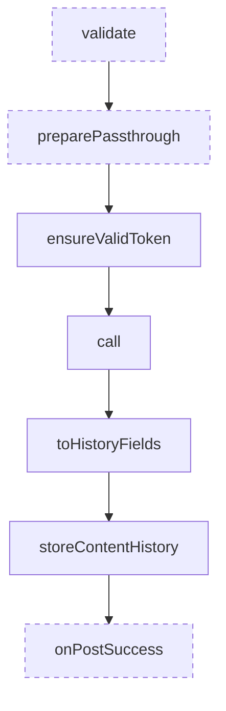
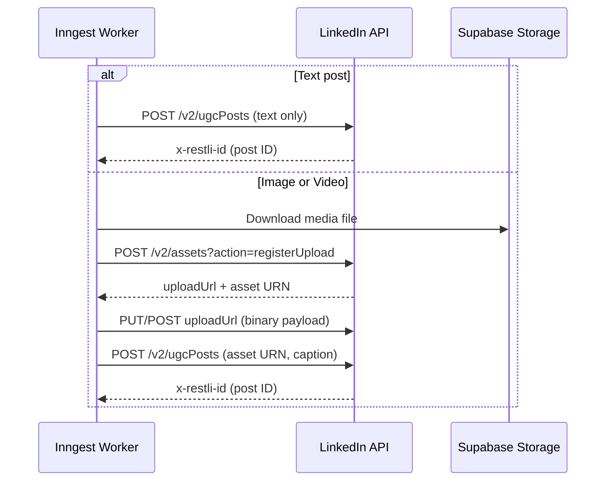
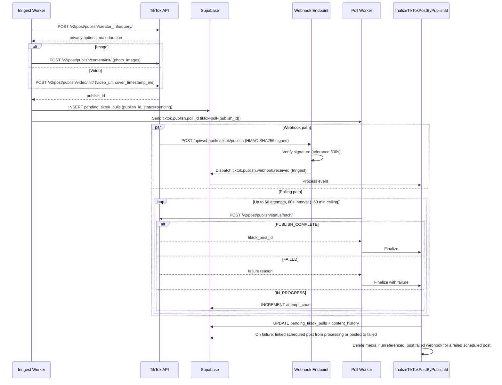
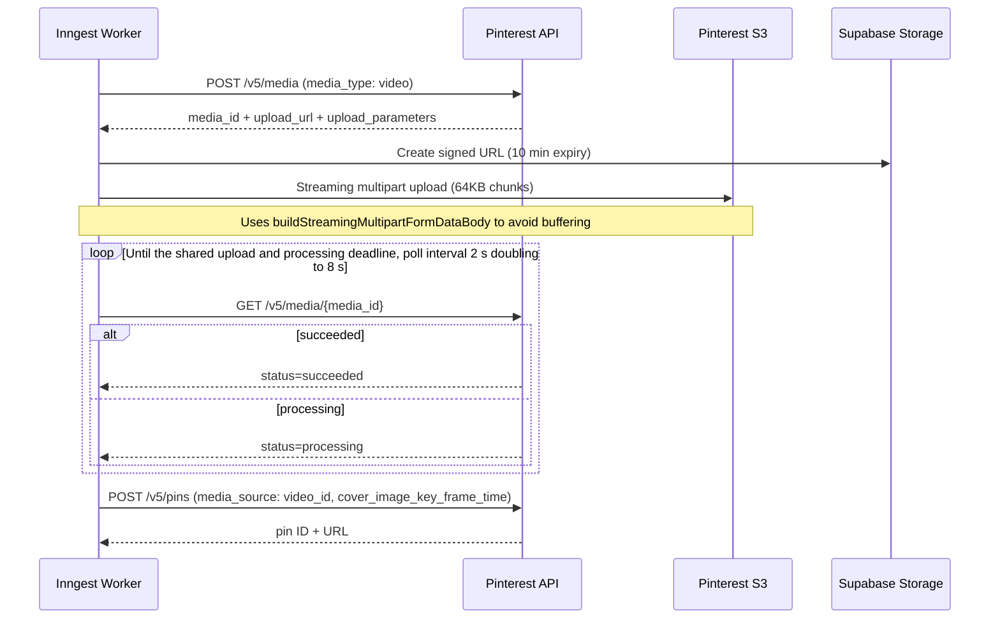
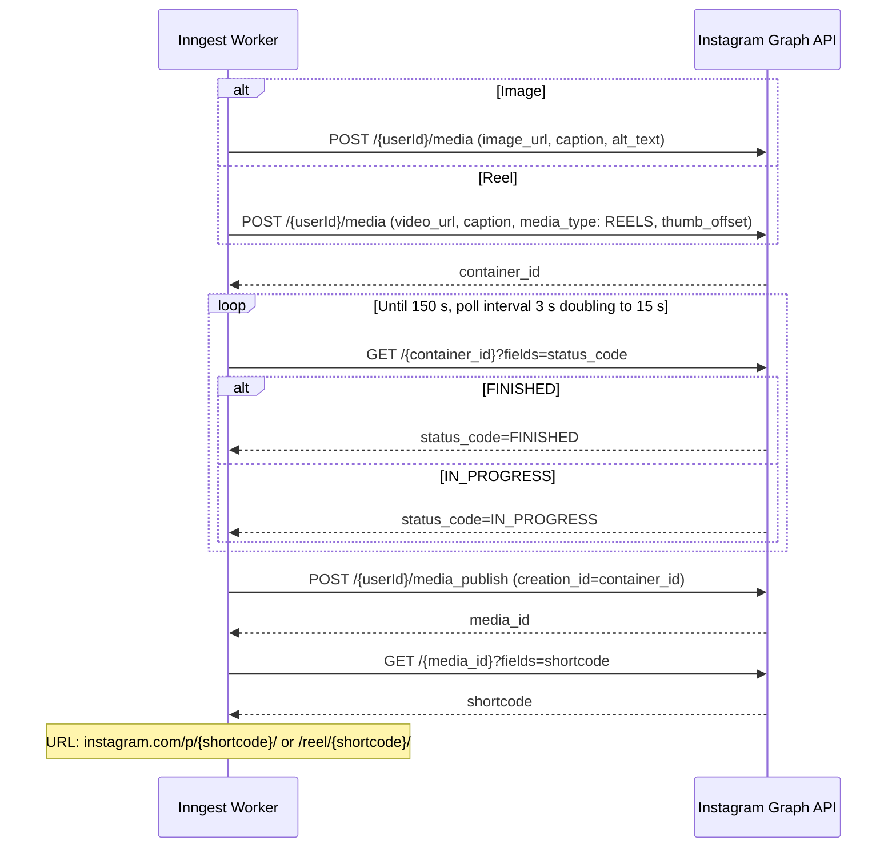

# Platforms

How Sharetopus posts content to LinkedIn, TikTok, Pinterest, Instagram, YouTube, X (Twitter), and Facebook through dedicated adapters, and to 21 more platforms through the provider registry. The seven adapters share a generic adapter pattern but differ in token behavior, media upload mechanics, and post lifecycle.

The platform capability registry (which platform accepts which media type) lives in `src/lib/platforms/capabilities.ts` and feeds the create form, the account selector, the REST/MCP/x402 schemas, and the Inngest compatibility check.

[Back to README](../README.md)

## Table of Contents

- [Generic Adapter Pattern](#generic-adapter-pattern)
- [Platform Support Matrix](#platform-support-matrix)
- [LinkedIn](#linkedin)
- [TikTok](#tiktok)
- [Pinterest](#pinterest)
- [Instagram](#instagram)
- [YouTube](#youtube)
- [X (Twitter)](#x-twitter)
- [Facebook](#facebook)
- [Future Platforms](#future-platforms)
- [Adding a New Platform](#adding-a-new-platform)
- [Source Files Referenced](#source-files-referenced)

---

## Generic Adapter Pattern

Every platform implements a thin adapter over `directPostForAccountsGeneric` (`src/lib/api/_shared/directPostForAccountsGeneric.ts`). The generic function handles token validation, history storage, and error handling. Each platform only supplies the platform-specific logic via hooks. Both Inngest workers reach the adapters through `publishToPlatform` (`src/inngest/functions/publishToPlatform.ts`), which picks the adapter for the 7 dedicated platforms and `publishViaRegistry` for the rest.

### DirectPostPlatformAdapter Type

```typescript
DirectPostPlatformAdapter<TPassthrough, TPostResult>
```

**Hooks:**

| Hook | Required | Purpose |
|------|----------|---------|
| `validate` | No | Pre-flight checks (e.g., media type support) |
| `preparePassthrough` | No | Transform or enrich passthrough data before posting |
| `call` | Yes | Execute the actual API call to the platform |
| `toHistoryFields` | Yes | Map post result to content_history record fields |
| `onPostSuccess` | No | Side effects after successful post (e.g., insert the TikTok pull row and send the poll event); returns warnings |

### Execution Flow



Dashed boxes are optional hooks. If any step before the platform call fails, the flow short-circuits and returns the error result.

Every adapter returns a `DirectPostScheduleResult`. A failure carries `failure: { reason, mayHavePublished }` (`PlatformFailureReason` in `src/lib/api/_shared/platformFailure.ts`), classified from the platform's own error codes (Graph codes for Facebook and Instagram, TikTok error codes, YouTube reasons, HTTP status). The workers retry only `rate_limited` and `transient` failures with `mayHavePublished: false`. A success carries `warnings` for side effects that failed after the post went live (`content_history_not_recorded`, `tiktok_pull_not_recorded`, `tiktok_poll_not_sent`, `post_success_hook_failed`); the post still counts as published, and `publishToPlatform` logs each warning.

Every outbound platform call has a timeout (`src/lib/api/_shared/platformFetchTimeouts.ts`): 15 s for API calls, 30 s for publish calls, 45 s for image pulls, and up to 240 s for a media upload, derived so a whole publish fits the 290 s step budget (`RUNTIME.minStepBudgetS`).

Also in `_shared/`: `buildStreamingMultipartFormDataBody.ts`, which streams 64KB chunks for Pinterest video upload without buffering the full file in memory.

### Token Refresh

`ensureValidToken` (`src/lib/api/ensureValidToken.ts`) refreshes a token that expires within 5 minutes by default, and `publishViaRegistry` does the same for registry providers (`refreshRegistryAccountToken`). Both take an optional window: the daily worker `refresh-social-account-token` passes `{ refreshIfExpiringWithinMs: TOKEN_REFRESH_HORIZON_MS }` (7 days), so tokens that cannot be refreshed once expired (Instagram, Threads) are renewed a week ahead. Both run the refresh through `refreshWithAccountLock({ accountId, refreshTokenRotation, refreshStoredCredential, refreshIfExpiringWithinMs })` (`src/lib/api/refreshWithAccountLock.ts`), which applies the same window to the holder's re-read and the waiters' re-reads, so one run per account refreshes at a time.

Every platform states whether its refresh token rotates, as a typed fact next to its refresh call: `refreshTokenRotation` in `LEGACY_TOKEN_REFRESHERS` (`ensureValidToken.ts`) for the seven dedicated platforms, and next to `refresh` in each registry provider's behavior (the compiler refuses a `refresh` without it). `"rotating"` means a refresh can return a new refresh token and the platform does not promise the old one keeps working (RFC 6749 section 6 lets the server revoke it): X, TikTok, Pinterest, Bluesky, Tumblr, Twitch, Kick. `"stable"` means the platform documents that the refresh token is reused, or there is none: LinkedIn, YouTube, Google Business Profile, Reddit, Instagram, Threads, Facebook. Each entry cites its source.

- The holder takes the Upstash key `token_refresh_lock:<account id>` with `SET NX` and a 45 s TTL (`TOKEN_REFRESH_LOCK_TTL_MS`), the same for every platform. While it works it extends the key every 15 s with a script that runs `PEXPIRE` only while the key still holds its owner id, and it stops extending when its work ends, whatever the outcome. It stops extending once the key would outlive the function's 300 s limit (`RUNTIME.maxDurationS`; log `[renewLeaseUntilStopped] Stopped renewing <key>: the holder has run as long as a function can.`). The holder releases the key with a script that deletes it only while the holder still owns it.
- The holder re-reads the row before refreshing. If another run already saved a token that does not expire within the caller's window, it uses that token and skips the platform call. Otherwise it refreshes with the stored refresh token, which can be newer than the caller's copy.
- The holder works under a lease that ends at its confirmed end: the send time of its last successful `SET NX` or extend, plus 45 s. An extend that fails leaves that end where it was (`[renewLeaseUntilStopped] Could not renew <key>; its lease still ends at <time>.`); one that finds the key gone or held by another run ends the lease at once (`[renewLeaseUntilStopped] <key> is no longer held by this run; it will not store a refreshed token.`). The holder starts the platform call only while at least 25 s of the lease is left (the slowest rotating refresh request timeout, 20 s, plus a 5 s clock margin), else it answers "try again" (`[refreshIfStillExpiring] The refresh lock on account <id> lapses too soon to start a refresh.`). Its store carries the confirmed end: the UPDATE adds `clock_timestamp() < <confirmed end - 5 s>`, so Postgres refuses a store it runs after another run could hold the key. A store that waits longer than that in the database loses its new credential.
- The store (`storeRefreshedCredential`) writes only while the row still holds the `token_expires_at` this refresh read, and tries twice (`[storeRefreshedCredential] Write <n> of 2 failed for account <id>`). When it matches no row, `settleUnmatchedStore` re-reads: the row holding this refresh's access token means an earlier attempt committed; another fresh token means another run won (`[settleUnmatchedStore] Another refresh stored a newer token`), and the run uses it. Otherwise the new credential is lost: the dedicated path logs `[logLostTokenStore <platform>] RECONNECT REQUIRED` when the refresh token rotated, and the registry path returns a reconnect warning.
- Every other run polls the row, starting at 500 ms and doubling up to 4 s, and returns the token the holder saved. A waiter gives up after 50 s (`TOKEN_REFRESH_WAIT_DEADLINE_MS`) with a "try again" error. A lock left by a crashed run expires at most 45 s after the crash, and a waiter takes over. A holder that is alive but stuck keeps it up to 300 s, and waiters answer "try again" meanwhile.
- When Redis is unreachable, a rotating platform does not refresh: the run answers "try again" (`failureReason: "transient"`, so a post step retries) and logs `[refreshWithAccountLock] Lock unavailable, not refreshing account <id>: its refresh token rotates.` A stable platform refreshes without the lock and logs `[refreshWithAccountLock] Lock unavailable, refreshing account <id> without it`.

After a refused refresh, `settleRefusedRefresh` re-reads the row and uses the stored token when its expiry differs from the one the refresh started from (another run saved it). Otherwise it flags the account `is_available = false` with an UPDATE guarded on that old expiry and answers "reconnect" only when the UPDATE matched the row. When it matched nothing, the credential changed after the refusal: it re-reads and uses the stored token when fresh, else answers "try again"; a flag that fails also answers "try again". Registry providers follow the same rule.

X rotates its refresh token on every refresh, and the old one stops working. Before the lock, the second of two concurrent refreshes was refused, which failed that post and could flag a healthy account as needing a reconnect. The lock still depends on Redis keeping the key until it expires: a key lost earlier (eviction, failover) lets two runs refresh at once again.

---

## Platform Support Matrix

| Platform | Text | Image | Video | Scheduled | Direct | OAuth Flow |
|----------|------|-------|-------|-----------|--------|------------|
| LinkedIn | yes | yes | yes | yes | yes | Standard |
| TikTok | no | yes | yes | yes | yes | Standard + dev/prod credential split |
| Pinterest | no | yes | yes | yes | yes | Basic Auth token exchange |
| Instagram | no | yes | reel | yes | yes | Long-lived token upgrade |
| YouTube | no | no | yes | yes | yes | Google OAuth, offline access for refresh tokens |
| X (Twitter) | yes | yes | yes | yes | yes | OAuth 2.0 with mandatory PKCE, rotating refresh tokens |
| Facebook | yes | yes | yes | yes | yes | Long-lived user token, then non-expiring Page tokens |

---

## LinkedIn

**API:** v2 (UGC Posts API)
**Scopes:** `openid`, `profile`, `email`, `w_member_social`
**Token refresh:** Yes, via refresh_token grant; LinkedIn returns the same refresh token, its 365-day lifetime unchanged (stable)
**Member URN:** `urn:li:person:{account_identifier}`

### Posting Flow



Text-only posts skip media registration entirely and call the ugcPosts endpoint directly.

### Key Details

- Posting is throttled to 5 per minute per account by the Inngest workers (`perAccountThrottlePerMinute`), like every platform.
- Token refresh handled by `refreshLinkedinToken.ts`.
- The media upload has its own timeout (`LINKEDIN_MEDIA_UPLOAD_TIMEOUT_MS`), derived from the step budget.
- 5 source files total in the linkedin directory.

---

## TikTok

**API:** v2
**Scopes:** `user.info.basic`, `user.info.profile`, `video.publish`, `video.upload`, `user.info.stats`
**Token refresh:** Yes, via refresh_token grant; TikTok returns a different refresh token on every refresh (rotating)
**Dev/prod credentials:** Separate `TIKTOK_CLIENT_KEY_DEV` / `TIKTOK_CLIENT_SECRET_DEV` for development environments
**Media types:** Image, Video (no text-only posts)

TikTok is the most complex integration. It uses an async pull model (TikTok fetches media from a URL you provide) and has a dual completion path combining webhooks and polling.

### Posting and Completion Flow



Both paths converge on `finalizeTikTokPostByPublishId` (`src/actions/server/data/finalizeTikTokPostByPublishId.ts`), which is idempotent: only the first writer moves the pull out of `pending`. The poll worker checks if the webhook already finalized the record (status != "pending") before acting. The webhook can also backfill a missing `post_id`. A failure reaches the scheduled post: it moves from `processing` or `posted` to `failed` and fires `post.failed`. A pending pull that nobody polled for 10 minutes gets a new poll from `repoll-stalled-tiktok-pulls` (hourly at :40).

### Webhook Verification

The webhook endpoint at `/api/webhooks/tiktok/publish` validates incoming requests with HMAC-SHA256:

- Signature input: `${timestamp}.${rawBody}`
- Tolerance: 300 seconds
- Events handled: `post.publish.complete`, `post.publish.publicly_available`, `post.publish.failed`

### Media URL Delivery

TikTok pulls media from a URL. Two modes are supported:

1. **Proxy mode** (default): HMAC-signed `/api/media` URLs with 30-minute expiry. Signature computed as SHA-256 over `${principalId}:${mediaPath}:${expiresAt}`.
2. **supabase_direct mode**: Supabase signed URLs passed directly to TikTok.

Controlled by the `TIKTOK_MEDIA_SOURCE` environment variable.

### Deep Links

Post URLs follow this pattern: `https://www.tiktok.com/@{creator_username}/{segment}/{tiktok_post_id}`

The segment is determined from the publish_id prefix:
- `p_pub_` = `photo`
- `v_pub_` = `video`

### Key Details

- Cover timestamp: `video_cover_timestamp_ms` in milliseconds. Minimum 1000ms; values below are clamped.
- Privacy: the web composer sends the level the user picked; API, MCP and x402 posts carry no privacy choice and go out `PUBLIC_TO_EVERYONE` (`tikTokPrivacy.ts`).
- The poll worker runs 60 attempts at 60-second intervals, giving roughly a 60-minute ceiling for TikTok to pull and process media.
- 15 source files total in the tiktok directory (plus 1 shared finalize function).
- TikTok daily caps (`spam_risk_too_many_posts`, `reached_active_user_cap`) classify as `rate_limited` and are retried within the worker's 3 retries.

---

## Pinterest

**API:** v5
**Scopes:** `boards:read`, `boards:write`, `pins:read`, `pins:write`, `user_accounts:read`, `catalogs:read`, `catalogs:write`
**Token refresh:** Yes, ~30 day tokens; every refresh returns a new continuous refresh token (treated as rotating)
**Token exchange:** Basic Auth header with `base64(client_id:client_secret)`
**Media types:** Image, Video (no text-only posts)

### Image Posting

Images are straightforward. Pinterest accepts a URL directly:

```
POST /v5/pins
  board_id, title, description, media_source: { source_type: "image_url", url }
```

No file download or upload needed.

### Video Posting (Streaming Multipart S3 Upload)



### Key Details

- Cover timestamp: Pinterest uses `cover_image_key_frame_time` in **seconds** (not milliseconds). The code converts from ms to seconds.
- Board listing: `GET /v5/boards`, rate limited at 15 requests per 60 seconds.
- Board discovery is exposed via the MCP `list_pinterest_boards` tool (accepts `social_account_id`, `page_size`, `bookmark`).
- The upload and the processing wait share one deadline (`PINTEREST_VIDEO_UPLOAD_AND_PROCESSING_TIMEOUT_MS`), derived from the 290 s step budget.
- 10 source files total in the pinterest directory.

---

## Instagram

**API:** Graph API v23.0
**Scopes:** `instagram_business_basic`, `instagram_business_content_publish`
**Token:** No refresh tokens. Short-lived (1 hour) upgraded to 60-day long-lived via `ig_exchange_token` endpoint. Re-auth required when the long-lived token expires.
**Media types:** Image, Reel (video maps to Reel)

### Posting Flow (Container Model)



### Key Details

- Long-lived token upgrade happens during the OAuth exchange (`exchangeInstagramCode`). If the upgrade fails, the connect fails: a short-lived token cannot be refreshed and would die within the hour.
- The account is keyed on the `/me` `user_id`, the professional account ID `postToInstagram` publishes under, in both the web popup and the x402/REST flow.
- No refresh tokens exist, but the long-lived ACCESS token itself is refreshed before expiry via `/refresh_access_token` (`refreshInstagramToken.ts`, wired into `ensureValidToken`). An already-expired token still requires re-authorization.
- Alt text is supported for images. Derived from the description (first 1000 characters).
- `post_type: "video"` is always published as a Reel (`media_type: REELS`).
- Media must be publicly accessible (Instagram fetches from the URL). Supabase signed URLs satisfy this requirement.
- 5 source files total in the instagram directory.

---

## YouTube

**API:** YouTube Data API v3
**Scopes:** `https://www.googleapis.com/auth/youtube.upload`, `https://www.googleapis.com/auth/youtube.readonly`
**Token refresh:** Yes, Google refresh_token grant (`access_type=offline&prompt=consent` forces a refresh token on every connect)
**Account identifier:** channel id (from `channels.list?mine=true`)
**Media types:** Video only
**Env vars:** `YOUTUBE_CLIENT_ID`, `YOUTUBE_CLIENT_SECRET`, `YOUTUBE_REDIRECT_URL`, `X402_YOUTUBE_REDIRECT_URI`

### Posting Flow

Resumable upload in two steps, streaming the file bytes from Supabase Storage:

1. `POST /upload/youtube/v3/videos?uploadType=resumable&part=snippet,status` with the metadata JSON (title, description, privacyStatus); the session URL returns in the `Location` header.
2. `PUT` the video bytes to the session URL; the response carries the video id. Post URL: `https://www.youtube.com/watch?v={id}`.

### Key Details

- A title is mandatory; the adapter falls back to the first 100 characters of the caption, then "Untitled video".
- `post_options.privacyStatus` (`public` | `unlisted` | `private`, default `public`) maps to `status.privacyStatus`.
- A Google account without a YouTube channel fails the connect flow with a clear message.
- Unverified Google Cloud projects upload as private-locked until the app passes verification; expect that during development.

---

## X (Twitter)

**API:** X API v2
**Scopes:** `tweet.read`, `tweet.write`, `users.read`, `media.write`, `offline.access`
**Token refresh:** Yes, and X ROTATES the refresh token on every refresh; the new value is persisted each time
**PKCE:** Mandatory. The web flow keeps the verifier in an HTTP-only cookie; the x402/REST flow stores it in `social_connections.oauth_code_verifier`
**Account identifier:** numeric user id (from `GET /2/users/me`)
**Media types:** Text, Image, Video
**Env vars:** `X_CLIENT_ID`, `X_CLIENT_SECRET`, `X_REDIRECT_URL`, `X402_X_REDIRECT_URI`

### Posting Flow

- Text: `POST /2/tweets` with `{ text }`.
- Media: v2 chunked upload (the dedicated endpoints that replaced command-style upload in May 2025), then the tweet references the media id:
  1. `POST /2/media/upload/initialize` (JSON: media_type, total_bytes, media_category `tweet_image` or `tweet_video`)
  2. `POST /2/media/upload/{id}/append` (multipart, 4 MB segments)
  3. `POST /2/media/upload/{id}/finalize`
  4. `GET /2/media/upload?command=STATUS` polling while X transcodes video
  5. `POST /2/tweets` with `{ text, media: { media_ids: [id] } }`

### Key Details

- Confidential-client token calls use HTTP Basic auth (`client_id:client_secret`).
- Caption cap is 280 characters (enforced by `CAPTION_LIMITS.x` in the batch cores).
- Media upload endpoints have very low rate limits on the Free API tier (17 initialize/finalize per 24h); plan tier accordingly.

---

## Facebook

**API:** Graph API v23.0 (Pages)
**Scopes:** `pages_show_list`, `pages_manage_posts`, `pages_read_engagement`
**Token:** code -> short-lived user token -> long-lived user token (`fb_exchange_token`) -> PAGE tokens via `GET /me/accounts`. Page tokens minted from a long-lived user token do not expire, so `token_expires_at` is stored null and no refresh path exists.
**Account identifier:** Page id; the stored access token is the PAGE token (the user token is never stored)
**Media types:** Text, Image, Video
**Env vars:** `FACEBOOK_CLIENT_ID`, `FACEBOOK_CLIENT_SECRET`, `FACEBOOK_REDIRECT_URL`, `X402_FACEBOOK_REDIRECT_URI`

### Posting Flow

- Text: `POST /{pageId}/feed` with `{ message }`.
- Image: `POST /{pageId}/photos` with `{ url, caption }` (Facebook pulls the file from the signed URL).
- Video: `POST /{pageId}/videos` with `{ file_url, description }` (Facebook pulls the file).

### Key Details

- The web connect flow stores ONE `social_accounts` row PER managed Page. The x402/REST callback contract is one account per connection, so it stores the FIRST Page and logs how many were skipped; connect the rest through the web flow.
- Post URL: `https://www.facebook.com/{post_id}`.

---

## Future Platforms

The seven platforms above have dedicated adapters. Every other id in `SOCIAL_PLATFORMS` (`src/db/schema.ts`), Threads (`threads`), Bluesky (`bluesky`) and Google Business Profile (`gmb`) among them, publishes through the provider registry in `src/lib/platforms/providers/catalog.ts` instead of a dedicated adapter. A platform graduates to a dedicated adapter through the checklist below.

---

## Adding a New Platform

Checklist for implementing a new platform, matching how youtube/x/facebook were added:

1. Make sure the platform id is in `SOCIAL_PLATFORMS` (`src/db/schema.ts`). A new id goes there first: `bun run db:generate` writes the matching change to the `platform` CHECK constraints on `social_accounts`, `social_connections` and `pending_direct_posts`, and after a review of that SQL `bun run db:migrate` applies it (see [DATABASE.md](./DATABASE.md#schema-changes)). The `Platform` type follows the list on its own.
2. Register capabilities: add the key to `ADAPTER_PLATFORMS`, `PLATFORM_LABELS`, and `PLATFORM_MEDIA_SUPPORT` in `src/lib/platforms/capabilities.ts`, plus a `CAPTION_LIMITS` entry (`src/components/core/create/constants/captionLimits.ts`).
3. Create `src/lib/api/{platform}/`:
   - `data/`: `exchange{Platform}Code.ts` (takes the redirect URI, sends the request through `requestCodeExchange`), `get{Platform}Profile.ts`, `refresh{Platform}Token.ts` (when the platform has one)
   - `post/`: `postTo{Platform}.ts`, `directPostFor{Platform}Accounts.ts` (a `DirectPostPlatformAdapter`)
4. Wire the token lifecycle: an entry in `LEGACY_TOKEN_REFRESHERS` inside `src/lib/api/ensureValidToken.ts`, with its refresh call and its `refreshTokenRotation`, citing the platform doc that says whether a refresh keeps the old refresh token working.
5. Wire the connect: a case in `connectPlatformAccounts` (`src/lib/api/oauth/connectPlatformAccounts.ts`) that exchanges the code, reads the profile, and returns the account keyed on the platform's stable id. The web popup and the x402/REST callback both call it, so an account gets the same row whichever flow connected it.
6. Web OAuth routes via the shared helpers (`initiateWebOAuth`, `completeWebOAuthConnect`), each a few lines of config:
   - `/api/social/{platform}/initiate`
   - `/api/social/{platform}/connect`
7. x402/REST OAuth:
   - a builder case in `src/lib/x402/connect/buildOAuthUrl.ts`
   - a redirect URI case in `getOAuthRedirectUri` (`src/lib/x402/config.ts`) and the `X402_{PLATFORM}_REDIRECT_URI` env var. The callback exchanges with the redirect URI stored on the `social_connections` row, so the two always match.
8. Inngest workers: a case in `publishToPlatform` and an entry in `MEDIA_URL_KIND_BY_PLATFORM` (`src/inngest/functions/publishToPlatform.ts`); both workers publish through it.
9. UI: a section in the connections page using `ConnectPlatformButton`, and an icon in `allPlatformsIcons.tsx` / `SocialAvatarWrapper`.
10. Docs: x402 reference strings in `src/app/(marketing)/(api-reference)/docs/x402/data/endpoints.ts`, this file, and `.env.example`.

The zod platform enums derive from `src/lib/platforms/capabilities.ts`, so step 2 updates them automatically: the MCP posting tools, the REST post body and the content-history filters use `SCHEDULABLE_PLATFORMS` (the dedicated platforms plus every registry id); the x402 surface and the analytics filters use `ADAPTER_PLATFORMS`.

Adding a registry provider instead takes three entries, and the compiler refuses any of them missing: the id in `REGISTRY_PLATFORM_IDS`, one entry in `REGISTRY_PROVIDER_CATALOG` (`src/lib/platforms/providers/catalog.ts`; a credentials entry must list `credentialFields`), and a behavior declared `satisfies ProviderBehavior` with the same `authKind` in `PROVIDER_BEHAVIORS` (`src/lib/platforms/providers/registry.ts`).

A registry provider declares its posting rules in its catalog entry (`rules`): text limit, media types, and `titleRequired` when its publish refuses a post without a title. Per-post options it reads (a subreddit, a community) go in `REGISTRY_POST_OPTION_FIELDS` (`src/lib/platforms/postTargetOptions.ts`), and a required one gets a line in `findPostTargetIssues`, so the REST and MCP schemas reject a post that lacks it.

---

## Source Files Referenced

**Shared:**
- `src/lib/api/_shared/directPostForAccountsGeneric.ts` (generic adapter)
- `src/lib/api/_shared/platformFailure.ts` (typed failure reasons from platform error codes)
- `src/lib/api/_shared/platformFetchTimeouts.ts` (timeouts for every platform call)
- `src/inngest/functions/publishToPlatform.ts` (one publish path for adapters and registry providers)
- `src/lib/api/_shared/buildStreamingMultipartFormDataBody.ts` (streaming multipart for Pinterest video)
- `src/lib/api/ensureValidToken.ts` (token refresh for the seven dedicated platforms)
- `src/lib/api/refreshWithAccountLock.ts` (per-account refresh lock, shared with registry providers)

**LinkedIn** (`src/lib/api/linkedin/`):
- `post/postToLinkedIn.ts`
- `post/directPostForLinkedInAccounts.ts`
- `data/exchangeLinkedInCode.ts`
- `data/getLinkedInProfile.ts`
- `data/refreshLinkedinToken.ts`

**TikTok** (`src/lib/api/tiktok/`):
- `post/postToTikTok.ts`
- `post/postImage.ts`
- `post/postVideo.ts`
- `post/tikTokPrivacy.ts`
- `post/directPostForTikTokAccounts.ts`
- `fitPhotoForTikTok.ts`
- `data/exchangeTikTokCode.ts`
- `data/getTikTokProfile.ts`
- `data/getTikTokCreatorInfo.ts`
- `data/getTikTokCreatorInfoForAccount.ts`
- `data/refreshTikTokToken.ts`
- `getTikTokPublishStatus.ts`
- `buildProxiedTikTokMediaUrl.ts`
- `buildTikTokMediaUrl.ts`
- `buildSupabaseDirectTikTokMediaUrl.ts`

**Pinterest** (`src/lib/api/pinterest/`):
- `post/postToPinterest.ts`
- `post/postImage.ts`
- `post/createVideoPin.ts`
- `post/directPostForPinterestAccounts.ts`
- `data/exchangePinterestCode.ts`
- `data/getPinterestProfile.ts`
- `data/getPinterestBoards.ts`
- `data/pinterestBoardsForAccount.ts`
- `data/createPinterestBoard.ts`
- `data/refreshPinterestToken.ts`

**Instagram** (`src/lib/api/instagram/`):
- `post/postToInstagram.ts`
- `post/directPostForInstagramAccounts.ts`
- `data/exchangeInstagramCode.ts`
- `data/getInstagramProfile.ts`
- `data/refreshInstagramToken.ts`

**YouTube** (`src/lib/api/youtube/`):
- `post/postToYouTube.ts`
- `post/directPostForYouTubeAccounts.ts`
- `data/exchangeYouTubeCode.ts`
- `data/getYouTubeProfile.ts`
- `data/refreshYouTubeToken.ts`

**X** (`src/lib/api/x/`):
- `post/postToX.ts`
- `post/directPostForXAccounts.ts`
- `data/exchangeXCode.ts`
- `data/getXProfile.ts`
- `data/refreshXToken.ts`

**Facebook** (`src/lib/api/facebook/`):
- `post/postToFacebook.ts`
- `post/directPostForFacebookAccounts.ts`
- `data/exchangeFacebookCode.ts`
- `data/getFacebookPages.ts`

**Shared web OAuth** (`src/lib/api/oauth/web/`):
- `initiateWebOAuth.ts`
- `completeWebOAuthConnect.ts`

**Capability registry and providers:**
- `src/lib/platforms/capabilities.ts`
- `src/lib/platforms/providers/catalog.ts`, `registry.ts`, `publishViaRegistry.ts`

---

[Back to README](../README.md)
