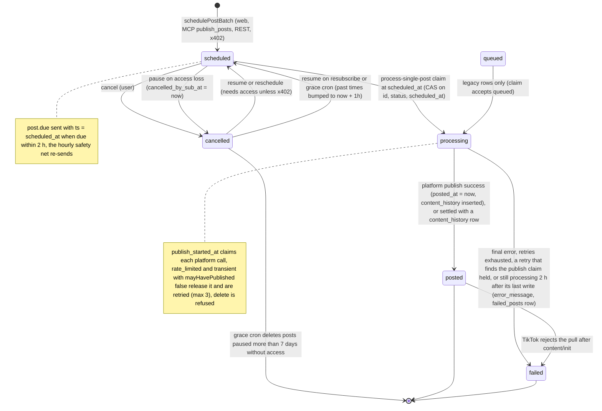
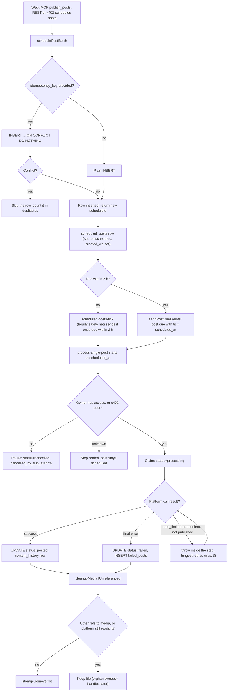
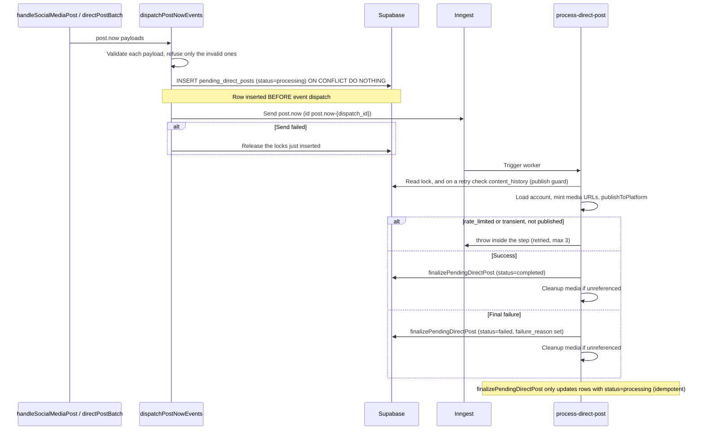
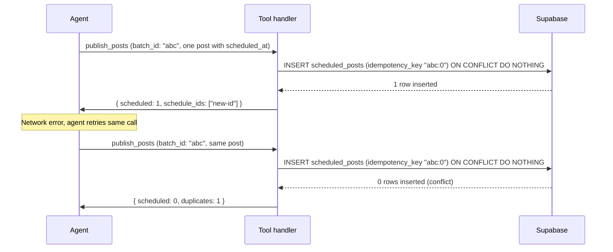

# Scheduling

How posts move from creation to publication. Covers the scheduled post state machine, direct posting, lock tables, fan-out, idempotency, retry behavior, and sweep crons.

[Back to README](../README.md)

## Table of contents

- [State machine](#state-machine)
- [Full lifecycle](#full-lifecycle)
- [Status transitions](#status-transitions)
- [Publish-time access gate](#publish-time-access-gate)
- [created_via](#created_via)
- [Direct posting (post now)](#direct-posting-post-now)
- [Cross-platform fan-out](#cross-platform-fan-out)
- [Lock tables](#lock-tables)
  - [pending_direct_posts](#pending_direct_posts)
  - [pending_tiktok_pulls](#pending_tiktok_pulls)
- [Idempotency](#idempotency)
- [Retry strategy](#retry-strategy)
- [Cancel, resume, reschedule, delete](#cancel-resume-reschedule-delete)
- [Subscription-triggered cancel](#subscription-triggered-cancel)
- [Sweep crons](#sweep-crons)
- [Source files referenced](#source-files-referenced)

## State machine

The `scheduled_posts.status` column drives all lifecycle transitions. Retryable errors do not produce a status change: the worker throws inside the publish step and Inngest retries that step with the row still `processing`.

`queued` is a legacy state: the claim and the safety net still accept it, nothing writes it any more.

## Full lifecycle

From creation through publish to media cleanup.

## Status transitions

| From | To | Trigger | Notes |
|------|-----|---------|-------|
| (new) | scheduled | schedulePostBatch | `created_via` set at insert time. `post.due` sent when due within 2 hours. |
| scheduled (or legacy queued) | processing | process-single-post claim | Compare-and-set on `id`, status `scheduled` or `queued`, and the event's `scheduled_at`, so a stale event for a rescheduled post claims nothing. Runs only after the access gate opens. |
| scheduled (or legacy queued) | cancelled | process-single-post access gate | Owner without access at publish time (x402 posts exempt). Sets `cancelled_by_sub_at`. Same CAS condition as the claim. |
| scheduled | cancelled | cancel | Only `scheduled` status can be cancelled. Clears `cancelled_by_sub_at`. |
| scheduled | cancelled | Stripe subscription event without access | Future posts only. Sets `cancelled_by_sub_at`. |
| cancelled | scheduled | resume or reschedule | Refused without access (x402 posts exempt). Past dates bumped to now + 1 hour on resume. Sends `post.due`. |
| cancelled | scheduled | resume on resubscribe, grace cron | Only rows with `cancelled_by_sub_at`. Past dates bumped to now + 1 hour. Sends `post.due`. |
| processing | posted | Platform publish success | `posted_at` set to `now()`. Content history inserted. `post.published` webhook. |
| processing | failed | Final platform error, retries exhausted with no `content_history` row, or still `processing` 2 h after its last write (settled by the hourly safety net) | Error recorded in `error_message`. `failed_posts` row inserted. `post.failed` webhook. |
| processing | failed | A retry finds `publish_started_at` set and no `content_history` row | Recorded as `unknown`: "An earlier publish attempt stopped before it reported a result; the post may have published". No platform call. |
| processing | (unchanged) | The row is gone or no longer `processing` when the attempt claims it | No platform call, nothing recorded. |
| processing or posted | failed | TikTok pull finalized as failed | `finalizeTikTokPostByPublishId`, then `post.failed` webhook. |

## Publish-time access gate

A scheduled post publishes only while its owner has access: an `active` or `trialing` Stripe subscription, or referral weeks (`users.creator_access_until` in the future). `process-single-post` checks it inside the claim step, after waiting for `scheduled_at` (`gatePostOnOwnerAccess` in `src/inngest/functions/processSinglePostHelpers.ts`):

- x402 posts (`created_via = 'x402'`) skip the check (`needsOwnerAccessToPublish` in `src/actions/checkActiveSubscription.ts`): a wallet principal has no plan and pays per post.
- No access: the post is paused exactly like a lost subscription (`status = 'cancelled'`, `cancelled_by_sub_at = now`, `buildAccessPauseValues`), and the run ends with `paused-without-access`. It comes back when access returns and is deleted after 7 days without it (see [Subscription-triggered cancel](#subscription-triggered-cancel)).
- Access read unavailable: the step throws, Inngest retries it, and the post stays unclaimed. If every retry fails, `onFailure` marks it failed. If `onFailure` cannot write, it throws and Inngest retries it once; the hourly safety net settles any post still `processing` 2 h after its last write. A post is never published on an unknown.

The gate reads the database each time, not the 60 s per-instance subscription cache, since a cached "active" could open it up to 60 s after access ended.

## created_via

Every post-related table (`scheduled_posts`, `failed_posts`, `content_history`) stores a `created_via` field that tracks origin. The value is threaded through `schedulePostBatch`, `storeContentHistory`, and `storeFailedPost` for per-origin analytics.

| Value | Meaning |
|-------|---------|
| `web` | Created through the web UI (`handleSocialMediaPost`) |
| `mcp` | Created through an MCP tool call |
| `x402` | Created through an x402 wallet payment or the Solana Blink (paid per post, exempt from the access gate) |
| `api` | Created through REST API |

REST API creates posts with `created_via = 'api'`. Webhook events (`post.scheduled`, `post.published`, `post.failed`) are dispatched on post lifecycle transitions via `src/lib/api/rest/webhooks/dispatch.ts`.

## Direct posting (post now)

Direct posts bypass the `scheduled_posts` table entirely. The flow uses `pending_direct_posts` as a lock table so media cleanup cannot race with in-flight publishes.

The lock row is inserted BEFORE the Inngest event is dispatched. This guarantees the row exists when the worker starts, even if Inngest picks up the event immediately. Every entry point checks access before it dispatches: the web action `handleSocialMediaPost` calls `checkActiveSubscription` for the signed-in user, MCP and REST pass the subscription gate at authentication, x402 and the Solana Blink are paid per post. The worker itself checks no access.

The adapter writes the `content_history` row when the platform accepts the post. When every retry fails, `onFailure` finalizes the lock: `completed` when the publish guard finds a `content_history` row, `failed` otherwise.

TikTok is a special case. On successful content/init, media cleanup is deferred to the poll or webhook worker because TikTok pulls the media asynchronously. Platforms that hotlink our signed URL keep the media too, since the live post may still read it.

## Cross-platform fan-out

A single user action can target multiple platforms. One `batch_id` groups all the resulting posts.

| Path | Max posts per call | Rate limit |
|------|--------------------|------------|
| `directPostBatch` (post now) | 30 | 20 per 60 seconds |
| `schedulePostBatch` (schedule) | 50 | 10 per 60 seconds |

`schedulePostBatch` also enforces a daily cap per principal and platform: posts in `scheduled`, `queued` or `processing` due within the next 24 hours, plus the new ones, may not exceed `platform_quotas.daily_cap` for that platform, 50 when the table has no row (`DEFAULT_PLATFORM_DAILY_CAP`).

## Lock tables

Two tables prevent premature media cleanup while posts are in flight. Both are checked by `deleteSupabaseFile` and `cleanupMediaIfUnreferenced` before removing any storage file.

### pending_direct_posts

One row per platform per dispatch. Tracks direct "post now" operations.

| Column | Purpose |
|--------|---------|
| `event_id` (PK) | Inngest event ID. Duplicate inserts treated as success. |
| `batch_id` | Groups multi-platform posts from one user action |
| `principal_id` | Owner |
| `social_account_id` | Target account |
| `platform` | Target platform |
| `media_storage_path` | File being used (prevents cleanup while in-flight) |
| `status` | `processing`, `completed`, `failed` |
| `failure_reason` | Error message on failure |
| `idempotency_key` | For dedup on retry |
| `finished_at` | Timestamp when finalized |

### pending_tiktok_pulls

Tracks TikTok async publish operations. TikTok's pull model means the publish can take minutes after the initial content/init call. This table keeps media alive until TikTok finishes pulling it.

| Column | Purpose |
|--------|---------|
| `publish_id` (PK) | TikTok publish ID from content/init response |
| `principal_id` | Owner |
| `social_account_id` | TikTok account |
| `scheduled_post_id` | FK to `scheduled_posts` (null for direct posts) |
| `content_history_id` | FK to `content_history` |
| `media_storage_path` | File being pulled by TikTok |
| `status` | `pending`, `completed`, `failed` |
| `attempt_count` | Number of poll attempts so far |
| `last_polled_at` | Timestamp of last poll |
| `finalized_at` | Timestamp when resolved |
| `failure_reason` | Error on terminal failure |
| `tiktok_post_id` | TikTok's post ID on success |
| `creator_username` | TikTok creator username for URL construction |

## Idempotency

Both batch cores support idempotent retries. This protects against duplicate posts when an agent retries after a network error or timeout.

`schedulePostBatch` inserts with `ON CONFLICT DO NOTHING` and counts a skipped row in `duplicates`; `directPostBatch` inserts its lock rows the same way, finds the existing lock by key for each conflict, and sends no second event. The key is optional. Omitting it means no dedup (every call creates a new row).

| Caller | Key source | Target table | Constraint |
|--------|-----------|--------------|------------|
| MCP `publish_posts` | Derived: `${batch_id}:${index}` when `batch_id` is passed | `scheduled_posts` or `pending_direct_posts` | UNIQUE on `(principal_id, idempotency_key)` |
| REST `POST /v1/posts`, x402 | `idempotency_key` param (optional, 1-200 chars) | the table of the path taken | Same |
| REST `POST /v1/posts/bulk` | `idempotency_key` per post, else `${batch_id}:${index}` | `scheduled_posts` | Same |

`post.due` events also deduplicate at the Inngest layer: the id `post.due-{postId}-{scheduledAtEpochMs}` is the same for every send of one `scheduled_at`, and Inngest drops a repeated id for 24 hours, so a writer and the hourly safety net never start two runs for one post. Only a post overdue by more than 15 minutes is re-sent under a fresh `-late-{nowMs}` id. A duplicate run that slips through still finds the claim taken. `post.now` events use the id `post.now-{dispatch_id}`.

## Retry strategy

Both workers retry, and both publish through `publishToPlatform`. Each platform returns a typed failure `{ reason, mayHavePublished }` (`PlatformFailureReason` in `src/lib/api/_shared/platformFailure.ts`), classified from the platform's own error codes.

**Retries (both workers):**

- Max retries: `RUNTIME.maxRetries` (default 3, capped at 20)
- Backoff: Inngest default exponential backoff
- Throttle: 5 per minute per `social_account_id`
- Publish guard: before publishing again, the step looks for a `content_history` row from an earlier attempt
- Publish claim (scheduled posts): right before the platform call, `claimPublishAttempt` sets `scheduled_posts.publish_started_at` with a compare-and-set on `status = 'processing'` and the column being null. When it matches no row, the step rereads the row: gone or no longer `processing` ends the run with no call; still `processing` means an earlier attempt holds the claim (killed after the platform may have accepted), so the post is recorded `failed` as `unknown`, "may have published", and the platform is never called again. A `rate_limited` or `transient` failure with `mayHavePublished: false` clears the claim (`releasePublishAttempt`) before the step throws, so its retry calls again. If that release fails, the retry records "may have published" instead of calling. Every claim to `processing` starts with the column cleared.

**Error classification (`isSafeToRetryPost` in `src/inngest/functions/platformErrors.ts`):**

| Reason | Retried | Example |
|--------|-----------|---------|
| `rate_limited` | Yes, when `mayHavePublished` is false | Platform 429 response |
| `transient` | Yes, when `mayHavePublished` is false | Network timeout, connection reset |
| `auth_expired` | No | Token expired, refresh refused |
| `policy_rejected` | No | Pinterest domain block, TikTok policy violation |
| `invalid_input` | No | Text post to Pinterest, missing board ID, media file gone |
| `unknown` | No | Unmapped error |

A failure with `mayHavePublished: true` is never retried, whatever its reason, since the platform may have accepted the post.

Final failures: `error_message` is recorded on the `scheduled_posts` row and a `failed_posts` row is inserted. A `post.failed` webhook fires, plus `connection.expired` for `auth_expired`.

Retried failures: the worker throws inside the publish step, Inngest retries that step with backoff. When every retry fails, `onFailure` records `posted` if the publish guard finds a `content_history` row and `failed` otherwise. It leaves a post whose publish claim is held to the hourly safety net, since an attempt may still be calling the platform or the failure event may come from another run that never claimed the post. If `onFailure` cannot write, it throws and Inngest retries it once; the hourly safety net settles any post still `processing` 2 h after its last write, also only when its publish claim is null or older than 2 h.

## Cancel, resume, reschedule, delete

| Operation | Behavior |
|-----------|----------|
| **Cancel** | Only posts with `status=scheduled` can be cancelled. Sets `status=cancelled` and clears `cancelled_by_sub_at`. |
| **Resume** | Moves `cancelled` posts back to `scheduled` and clears `cancelled_by_sub_at`. Past dates are bumped to now + 1 hour via `bumpPastScheduleToFuture`. Sends `post.due`. Refused without access unless every post is an x402 post: "Bringing back a cancelled post needs an active plan or referral weeks. Renew your subscription, then try again." |
| **Reschedule** | Changes `scheduled_at` for 1 to 50 posts in `scheduled` or `cancelled`. Automatically resumes cancelled posts (no separate resume call needed), clearing `cancelled_by_sub_at` like Resume, and sends `post.due`. When the batch holds a cancelled post that needs access and the owner has none, the batch is refused with `failure: "access_required"` (REST answers 403 `forbidden`); moving a post that is still `scheduled` needs no access check. |
| **Delete** | Permanent removal, any status but `processing`. A batch with a post that is publishing now is refused and nothing is deleted: "Post {id} is publishing now. Try again in a minute." (`failure: "not_eligible"`, REST 409 `conflict`, MCP tool error, x402 409 `post_publishing` before payment). The DELETE also carries `status <> 'processing'`, so a post a run claims after the read is kept and counted in `failed`. Media of the deleted posts that no other row references is deleted (`deleteUnreferencedMediaFiles`). Disconnecting a social account deletes its posts through the foreign key, so `disconnectSocialAccount` refuses while a `scheduled_posts` or `pending_direct_posts` row on the account is in `processing`: "A post on this account is publishing now. Try again in a minute." The check sits in the DELETE itself (`not exists`), so a post claimed after the earlier reads still blocks it. Only the web app disconnects; REST, MCP and x402 have no disconnect endpoint. |

The access checks for Resume and Reschedule live in the batch functions (`checkAccessToRevivePosts`), so the web actions, MCP `update_scheduled_posts`, REST `PATCH /v1/posts/{id}` and the x402 reschedule route all apply them. An unreadable plan refuses with "Could not check your plan, so nothing changed. Please try again." (`failure: "unavailable"` on reschedule).

All four answer "Could not load your posts. Please try again." when reading the posts fails; "No posts found" means the ids matched no row.

## Subscription-triggered cancel

When a user loses access, the system pauses their future scheduled posts and provides a grace period before cleanup.

1. Any Stripe subscription event (`customer.subscription.created`, `updated` or `deleted`) that leaves the user without access runs `cancelFutureScheduledPostsOnSubCancel`: `status=cancelled` and `cancelled_by_sub_at=now()` for all future `scheduled` posts of that user (`src/app/api/webhooks/stripe/route.ts`, `revokeSubscriberAccess`).
2. Referral weeks run out without any event. The publish-time access gate pauses each such post when it comes due, with the same two columns.
3. A Stripe event with access runs `resumeCancelledPostsOnResubscribe`: every `cancelled` row with `cancelled_by_sub_at` goes back to `scheduled`, past dates are bumped one hour ahead, and `post.due` is sent.
4. The `cleanup-cancelled-posts-after-grace` cron (daily 05:00 UTC) resumes the paused posts of every principal who has access again (this is how posts come back when referral weeks are granted again), and deletes posts paused more than 7 days ago for principals still without access.

Only an access loss sets `cancelled_by_sub_at`; a manual cancel, resume or reschedule clears it. The tag therefore marks a post whose latest cancellation came from the access loss. Before this rule, a post resumed by hand kept its tag, and cancelling it again later let the grace cleanup delete it.

## Sweep crons

Three crons recover stuck or orphaned data.

| Cron | Schedule | Behavior |
|------|----------|----------|
| `scheduled-posts-tick` | Hourly at :00 | Re-sends `post.due` for unclaimed posts (`scheduled` or legacy `queued`) due within 2 hours; posts overdue by more than 15 minutes get a fresh event id. Then settles posts still `processing` 2 hours after their last write and whose publish claim is null or older than 2 hours: `posted` with a `content_history` row, else `failed` ("Publishing stopped without a result; the post may have published") |
| `sweep-stuck-direct-posts` | Hourly at :15 | Marks `pending_direct_posts` rows still `processing` 60 minutes after `created_at` as `failed` |
| `sweep-orphan-storage-files` | Daily at 03:00 UTC | Deletes storage files older than 24 hours that are not referenced by any of the 4 media tables |

## Post options

Platform-specific options are stored in the `post_options` JSONB column on `scheduled_posts`, flat. `decodeStoredPostOptions` in `src/inngest/events/postOptions.ts` is the schema the worker reads them with; a row with an unknown type for a known key fails as `invalid_input`.

| Platform | Fields |
|----------|--------|
| Pinterest | `board`, `boardName`, `link`, `privacyLevel` |
| LinkedIn | `link`, `visibility` |
| YouTube | `privacyStatus` (`public`, `unlisted`, `private`) |
| TikTok | `privacyLevel` (web composer only; API, MCP and x402 posts are always public), `disableComment`, `disableDuet`, `disableStitch`, `brandContentToggle`, `yourBrand`, `brandedContent`, `isAigc` |
| Registry providers | Their own keys, checked by `publishViaRegistry` |

## Source files referenced

| File | What it does |
|------|-------------|
| `src/inngest/events/postDue.ts` | `post.due` schema, 2-hour lookahead, event ids (`planPostDueEvents`) |
| `src/inngest/dispatch/sendPostDueEvents.ts` | Sends `post.due` from every writer of `scheduled_at` |
| `src/inngest/functions/scheduledPostsTick.ts` | Hourly safety net over unclaimed posts due within 2 hours |
| `src/inngest/functions/processSinglePost.ts` | Worker that gates on access, claims and publishes a scheduled post |
| `src/inngest/functions/processSinglePostHelpers.ts` | Load, access gate, claim, publish guard, status write, media cleanup |
| `src/inngest/functions/processDirectPost.ts` | Worker for direct "post now" operations (3 retries) |
| `src/inngest/dispatch/dispatchPostNowEvents.ts` | Locks and sends `post.now`, releases the locks on a failed send |
| `src/inngest/functions/publishToPlatform.ts` | One publish path for adapters and registry providers, media URL minting |
| `src/inngest/functions/platformErrors.ts` | Retry rule (`isSafeToRetryPost`) |
| `src/inngest/functions/sweepStuckDirectPosts.ts` | Sweep for stuck `pending_direct_posts` rows |
| `src/inngest/functions/sweepOrphanStorageFiles.ts` | Daily cleanup of unreferenced storage files |
| `src/inngest/functions/cleanupCancelledPostsAfterGraceCron.ts` | Daily resume or 7-day grace deletion of paused posts |
| `src/actions/checkActiveSubscription.ts` | Access rule (`checkActiveSubscription`, `findPrincipalsWithAccess`, `needsOwnerAccessToPublish`) |
| `src/actions/server/scheduleActions/schedule/schedulePostBatch.ts` | Core scheduling logic, fan-out for scheduled posts (max 50, rate limited, daily cap) |
| `src/actions/server/directPostActions/directPostBatch.ts` | Fan-out for direct posts (max 30, rate limited) |
| `src/actions/server/data/pendingDirectPosts.ts` | Lock insert, release and idempotent finalization of direct post lock rows |
| `src/actions/server/scheduleActions/cancel/cancelScheduledPostBatch.ts` | Cancel scheduled posts |
| `src/actions/server/scheduleActions/resume/resumeScheduledPostBatch.ts` | Resume cancelled posts |
| `src/actions/server/scheduleActions/resume/_shared/checkAccessToRevivePosts.ts` | Access check before a cancelled post comes back |
| `src/actions/server/scheduleActions/reschedule/updateScheduledTimeBatch.ts` | Reschedule posts |
| `src/actions/server/scheduleActions/delete/deleteScheduledPostBatch.ts` | Delete scheduled posts |
| `src/actions/server/data/cancelFutureScheduledPostsOnSubCancel.ts` | Pause on access loss (`buildAccessPauseValues`) |
| `src/actions/server/data/resumeCancelledPostsOnResubscribe.ts` | Resume posts on resubscribe |
| `src/actions/server/data/storageFiles/deleteSupabaseFile.ts` | Checks every media reference before deleting media |
| `src/actions/server/data/storageFiles/mediaReferences.ts` | Cross-table reference check before media removal |
| `src/lib/api/rest/webhooks/dispatch.ts` | REST webhook event dispatch on post lifecycle transitions |

---

**See also:** [docs/SECURITY.md](./SECURITY.md) (idempotency deep dive), [docs/INNGEST.md](./INNGEST.md) (worker details, retry config), [docs/MCP.md](./MCP.md) (publish_posts and update_scheduled_posts params)

[Back to README](../README.md)
