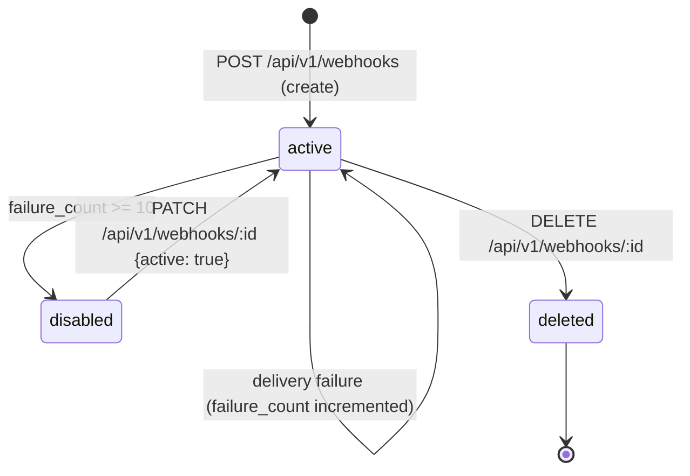
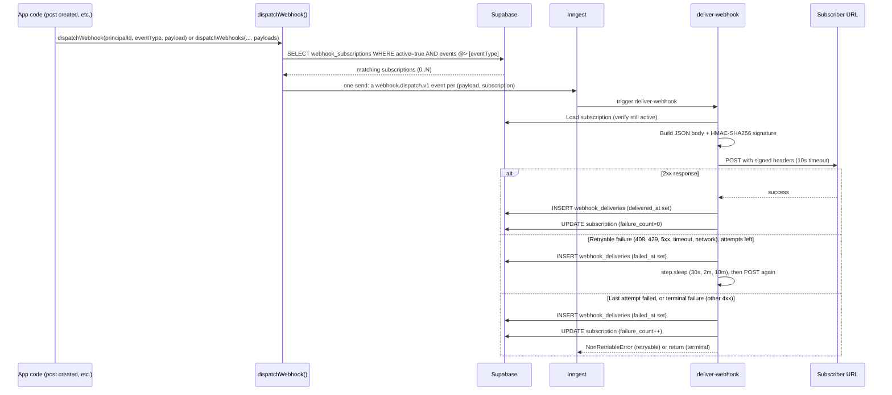

# Webhooks

Outbound webhook subsystem for notifying external services when events occur in a Sharetopus account. Subscriptions are created via the REST API or the Settings UI. Each delivery is HMAC-SHA256 signed so recipients can verify authenticity.

[Back to README](../README.md)

## Table of contents

- [Event types](#event-types)
- [Payloads](#payloads)
- [When post events fire](#when-post-events-fire)
- [Subscription lifecycle](#subscription-lifecycle)
- [Delivery pipeline](#delivery-pipeline)
- [Signing and verification](#signing-and-verification)
- [Retry behavior](#retry-behavior)
- [Auto-disable](#auto-disable)
- [Replay](#replay)
- [Testing](#testing)
- [Database tables](#database-tables)
- [Dispatch integration points](#dispatch-integration-points)
- [Tradeoffs and limitations](#tradeoffs-and-limitations)
- [Source files referenced](#source-files-referenced)

---

## Event types

5 event types, defined in `src/lib/api/rest/webhooks/eventTypes.ts`:

| Event | Trigger |
|-------|---------|
| `post.scheduled` | A post was scheduled (via web, MCP, or REST API) |
| `post.published` | A post was published successfully |
| `post.failed` | A post failed to publish (terminal) |
| `connection.connected` | A social account was connected |
| `connection.expired` | A post failed because its social account's login expired (`auth_expired`) |

Subscribers select which events they want when creating a subscription. Only matching events are dispatched.

---

## Payloads

Every delivery body is `{ event_type, event_id, delivery_id, created_at, data }` (`deliverWebhook.ts`). `data` holds the event's payload:

| Event | `data` |
|-------|--------|
| `post.scheduled` | `{ post_id, batch_id }` |
| `post.published` for a scheduled post | `{ post_id, platform }` |
| `post.published` for a publish-now dispatch | `{ dispatch_id, batch_id, platform, social_account_id }` |
| `post.failed` for a scheduled post | `{ post_id, platform, reason, error_message, may_have_published }` |
| `post.failed` for a publish-now dispatch | `{ dispatch_id, batch_id, platform, social_account_id, reason, error_message, may_have_published }` |
| `connection.connected` | `{ connection_id, social_account_id, platform, initiated_via, share_link_id }` |
| `connection.expired` | `{ social_account_id, platform, reason: "auth_expired" }` |

- `dispatch_id` is the id the publish-now answer returned for that post (`dispatch_id` in the REST 202, `event_ids` in the MCP `publish_posts` answer, `eventIds` in the x402 post-now answer), so a client can match the event to its request. `batch_id` is the batch the post was sent in.
- `reason` is one of `auth_expired`, `rate_limited`, `transient`, `policy_rejected`, `invalid_input`, `unknown` (`PlatformFailureReason` in `src/lib/api/_shared/platformFailure.ts`).
- `may_have_published` is `true` when the post may be live although it was recorded failed: the platform's answer was unclear, a publish attempt stopped before it reported a result, or a sweep failed a post that never reported a result. Check the account before posting again. It is `false` when the platform refused the post, a TikTok rejection included.
- `src/lib/api/rest/webhooks/postWebhookPayloads.ts` builds the publish-now fields, the three failure fields and the `connection.expired` payload, so every producer names them the same way.

---

## When post events fire

| Producer | Fires |
|----------|-------|
| Scheduled post run (`process-single-post`, its failure handler, and the 2 h safety net in `scheduled-posts-tick`) | `post.published` or `post.failed` once the post's row moves from `processing` to `posted` or `failed`; `connection.expired` with an `auth_expired` failure. The safety net records `failed` with `may_have_published: true`. |
| Publish-now run (`process-direct-post` and its failure handler) | `post.published` or `post.failed` once the dispatch is recorded `completed` or `failed`; `connection.expired` with an `auth_expired` failure. |
| Hourly publish-now sweep (`sweep-stuck-direct-posts`) | `post.failed` with `reason: "unknown"` and `may_have_published: true` for a dispatch still `processing` 1 h after it was created whose publish claim is null or also older than 1 h. |
| TikTok status (`tiktok-publish-status-poll` and `process-tiktok-publish-webhook`) | `post.failed` with `may_have_published: false` when TikTok rejects a post after accepting its upload (`content/init`). The scheduled post moves from `processing` or `posted` to `failed`, the dispatch from `processing` or `completed`. A post already `failed` fires nothing. A TikTok success after a post was recorded `failed` changes nothing. |

- An event fires only after the write that recorded the outcome matched the row, so two writers never both fire for one outcome. A dispatch the sweep failed stays failed: a run that ends later records nothing and fires nothing.
- A TikTok rejection can follow the `post.published` that the accepted upload fired. Take the later `post.failed` as the final state.
- A worker stopped while it sends an event can send the same outcome again under a new `event_id`. Deduplicate on `post_id` or `dispatch_id` with the event type.
- A publish-now TikTok post reaches its dispatch through its `content_history` row (same batch, account, platform and media file). When two dispatches of one batch match, neither changes and no event fires.

---

## Subscription lifecycle



On creation, the API generates a `whsec_` prefixed secret (32 bytes hex, 64 chars) via `generateWebhookSecret()` in `src/lib/api/rest/webhooks/secretGenerator.ts`. The secret is shown once in the response and stored AES-256-GCM encrypted (not hashed, because the delivery worker needs the raw secret to sign outbound payloads; see [SECURITY.md](./SECURITY.md#tokens-and-secrets-at-rest)).

---

## Delivery pipeline



`dispatchWebhook()` and `dispatchWebhooks()` in `src/lib/api/rest/webhooks/dispatch.ts` are fire-and-forget. They never throw: a failed read or send is logged. If no subscriptions match, they return silently. `dispatchWebhooks` takes a list of payloads and makes one subscription read and one Inngest send for the whole list; each payload gets its own `event_id`, and each (payload, subscription) pair its own Inngest event, so retries and failures are per subscription. The work is registered with `waitUntil` (`@vercel/functions`), so a caller that does not await it still has the send finish before the function is frozen.

---

## Signing and verification

Every delivery includes these headers:

| Header | Value |
|--------|-------|
| `X-Sharetopus-Signature` | `sha256=<hex digest>` |
| `X-Sharetopus-Event` | Event type (e.g. `post.published`) |
| `X-Sharetopus-Delivery` | Delivery UUID |
| `User-Agent` | `Sharetopus-Webhook/1.0` |
| `Content-Type` | `application/json` |

**Signing algorithm:** `HMAC-SHA256(rawBodyString, subscription_secret)` via `signWebhookPayload()` in `src/lib/api/rest/webhooks/signWebhookPayload.ts`.

**Verification (recipient side):**

```javascript
const crypto = require("crypto");

function verify(rawBody, secret, signatureHeader) {
  const expected = crypto
    .createHmac("sha256", secret)
    .update(rawBody)
    .digest("hex");
  const received = signatureHeader.replace("sha256=", "");
  return crypto.timingSafeEqual(
    Buffer.from(expected, "hex"),
    Buffer.from(received, "hex")
  );
}
```

Use the raw request body as a string (before JSON parsing). Use constant-time comparison to prevent timing attacks.

---

## Retry behavior

One `deliver-webhook` run makes every attempt for one event and one subscription. Each side effect is its own Inngest step, and Inngest retries only the step that threw:

- `send-N`: load the subscription, sign the body, POST (attempt N).
- `record-delivery-N`: insert the `webhook_deliveries` row for attempt N.
- `reset-failure-count` after a 2xx, or `count-failure` once after the last failed attempt.

Limits:

- **Attempts:** at most 4 POSTs per event and subscription, with waits of 30 s, 2 min and 10 min between them (`RETRY_DELAYS_BEFORE_NEXT_ATTEMPT` in `deliverWebhook.ts`).
- **Step retries:** a step that throws on a database error is retried up to 3 times. A failed log or counter write never sends the POST again.
- **Throttle:** 100 deliveries per 60 seconds per subscription (keyed on `event.data.subscription_id`)
- **Timeout:** 10 seconds per delivery attempt (`DELIVERY_TIMEOUT_MS` in `deliverWebhook.ts`)
- **Event schema:** `webhookDispatchEvent` in `src/inngest/events/webhookDispatch.ts`. Inngest validates the event data before the handler runs, so a malformed event is one failed run.

**Retryable failures** (next attempt after the wait):
- Status codes: 408, 429, 500, 502, 503, 504
- Network errors (timeout, connection refused, DNS failure)
- After the 4th retryable failure, `count-failure` runs and the run fails with `NonRetriableError`.

**Terminal failures** (no further attempt):
- All other 4xx status codes (400, 401, 403, 404, etc.)
- Recorded in `webhook_deliveries`, then `count-failure` runs and the run ends.

**At least once:** if the process stops after a POST and before Inngest stores the `send-N` result, the step runs again and the subscriber receives the same `event_id` with a new `delivery_id`. Receivers deduplicate on `event_id`.

**Deleted subscription:** if the subscription is deleted between the POST and the log insert, the insert fails on the foreign key (the table cascades on delete) and the worker skips the row.

---

## Auto-disable

Subscriptions are automatically disabled after 10 failed deliveries in a row (`AUTO_DISABLE_THRESHOLD` in `deliverWebhook.ts`). A delivery counts once, after its last attempt, not once per POST. The worker increments `failure_count` in a single UPDATE from the stored value, so concurrent deliveries do not overwrite each other's counts, and a subscription the user disabled while a delivery was running stays disabled.

When disabled:
- `active` is set to `false`
- `last_disabled_at` is set to the current timestamp
- No further deliveries are attempted

To re-enable:

```bash
curl -X PATCH https://sharetopus.com/api/v1/webhooks/SUB_ID \
  -H "Authorization: Bearer stp_rest_YOUR_KEY" \
  -H "Content-Type: application/json" \
  -d '{"active": true}'
```

Re-enabling resets `failure_count` to 0 so the auto-disable counter starts fresh.

---

## Replay

Re-send a past delivery:

```bash
curl -X POST https://sharetopus.com/api/v1/webhooks/SUB_ID/deliveries/DELIVERY_ID/replay \
  -H "Authorization: Bearer stp_rest_YOUR_KEY"
```

The replay endpoint queues one `webhook.dispatch.v1` Inngest event for that subscription only, carrying the original delivery's `event_id` and payload, so a receiver that deduplicates on `event_id` can recognize it. The new delivery gets its own delivery ID, signature, and delivery record. If the event cannot be queued, the endpoint returns 500.

---

## Testing

Send a test event to verify your endpoint:

```bash
curl -X POST https://sharetopus.com/api/v1/webhooks/SUB_ID/test \
  -H "Authorization: Bearer stp_rest_YOUR_KEY"
```

This sends a synthetic event synchronously (10 second timeout, no Inngest) and returns the actual delivery result. The attempt is recorded in `webhook_deliveries`; if that insert fails, the response still reports the delivery and the error is logged.

---

## Database tables

Two tables in Supabase:

**`webhook_subscriptions`:** User-created webhook endpoint registrations.

| Column | Type | Notes |
|--------|------|-------|
| id | UUID | PK |
| principal_id | UUID | FK to principals |
| url | text | HTTPS endpoint URL |
| events | text[] | Array of subscribed event types |
| secret | text | `whsec_` prefixed HMAC secret (stored encrypted, decrypted on read) |
| active | boolean | Default true, set false on auto-disable |
| failure_count | integer | Consecutive failures, reset on success |
| last_delivery_at | timestamptz | Last successful delivery |
| last_disabled_at | timestamptz | Last time auto-disabled |
| created_at | timestamptz | |
| updated_at | timestamptz | |

**`webhook_deliveries`:** Record of each delivery attempt.

| Column | Type | Notes |
|--------|------|-------|
| id | UUID | PK (the delivery_id) |
| subscription_id | UUID | FK to webhook_subscriptions |
| event_type | text | e.g. `post.published` |
| event_id | UUID | Groups deliveries of the same event |
| payload | jsonb | Full event payload |
| status_code | integer | HTTP response status (null on network error) |
| response_body | text | First 4096 chars of response |
| attempt | integer | Attempt number |
| latency_ms | integer | Time from request to response |
| delivered_at | timestamptz | Set on 2xx |
| failed_at | timestamptz | Set on non-2xx or network error |
| error_message | text | Network error message if applicable |
| created_at | timestamptz | |

---

## Dispatch integration points

`dispatchWebhook()` and `dispatchWebhooks()` are called from these locations:

| Location | Event dispatched |
|----------|-----------------|
| `src/inngest/functions/processSinglePostHelpers.ts` (`writePostOutcome`, for `recordPostStatus` and `finalizeProcessingPost`) | `post.published`, `post.failed` (after a scheduled post is recorded `posted` or `failed`), `connection.expired` (when that failure is `auth_expired`) |
| `src/inngest/functions/processDirectPost.ts` (`notifyDirectPostOutcome`) | `post.published`, `post.failed` (after a publish-now dispatch is recorded `completed` or `failed`, by the run or its failure handler), `connection.expired` (when that failure is `auth_expired`) |
| `src/inngest/functions/sweepStuckDirectPosts.ts` | `post.failed` (one `dispatchWebhooks` call per principal for the dispatches the hourly sweep failed) |
| `src/inngest/functions/tikTokPullFinalizeSteps.ts` | `post.failed` (TikTok rejected a scheduled post or a publish-now dispatch after content/init) |
| `src/actions/server/scheduleActions/schedule/schedulePostBatch.ts` | `post.scheduled` (one `dispatchWebhooks` call for every inserted row) |
| `src/lib/x402/oauth/callback/handleOAuthCallback.ts` | `connection.connected` (after the REST, MCP, share-link or x402 OAuth callback) |

A connection made from the web app fires no `connection.connected`.

---

## Tradeoffs and limitations

- **Secret encrypted, not hashed.** The delivery worker needs the raw secret to compute the HMAC signature, so the secret is encrypted with the deployment's `SOCIAL_TOKEN_ENCRYPTION_KEY` instead of hashed. A database dump alone yields ciphertext; a leak of both the database and the key exposes every secret. Secrets are per-subscription and can be rotated by deleting and recreating the subscription.
- **No cleanup cron for `webhook_deliveries`.** The delivery log grows indefinitely. A retention cron (similar to `cleanup-mcp-audit-log`) would be a future addition.
- **Delivery timeout is fixed at 10 seconds.** Not configurable per subscription.

---

## Source files referenced

| File | Description |
|------|-------------|
| `src/lib/api/rest/webhooks/dispatch.ts` | `dispatchWebhook()` fire-and-forget dispatcher, `sendWebhookDispatchEvent()` (one event to one subscription, also used by replay) |
| `src/lib/api/rest/webhooks/eventTypes.ts` | `WEBHOOK_EVENT_TYPES` array (5 events) |
| `src/lib/api/rest/webhooks/postWebhookPayloads.ts` | Publish-now fields, `post.failed` failure fields and the `connection.expired` payload |
| `src/lib/api/rest/webhooks/signWebhookPayload.ts` | HMAC-SHA256 signing function |
| `src/lib/api/rest/webhooks/secretGenerator.ts` | `generateWebhookSecret()` (`whsec_` prefix + 32 bytes hex) |
| `src/lib/api/rest/webhooks/verifyWebhookConfig.ts` | Subscription URL validation |
| `src/inngest/functions/deliverWebhook.ts` | Inngest function: deliver one webhook event |
| `src/app/api/v1/webhooks/route.ts` | POST (create) + GET (list) subscription endpoints |
| `src/app/api/v1/webhooks/[id]/route.ts` | GET + PATCH + DELETE subscription endpoints |
| `src/app/api/v1/webhooks/[id]/test/route.ts` | POST test delivery endpoint |
| `src/app/api/v1/webhooks/[id]/deliveries/route.ts` | GET delivery log endpoint |
| `src/app/api/v1/webhooks/[id]/deliveries/[delivery_id]/replay/route.ts` | POST replay endpoint |
| `src/lib/api/rest/validation/webhookSchemas.ts` | Zod validation schemas for webhook endpoints |

---

**See also:** [docs/REST.md](./REST.md) (REST API endpoints), [docs/SECURITY.md](./SECURITY.md) (webhook signing, threat model), [docs/INNGEST.md](./INNGEST.md) (deliver-webhook function)

[Back to README](../README.md)
